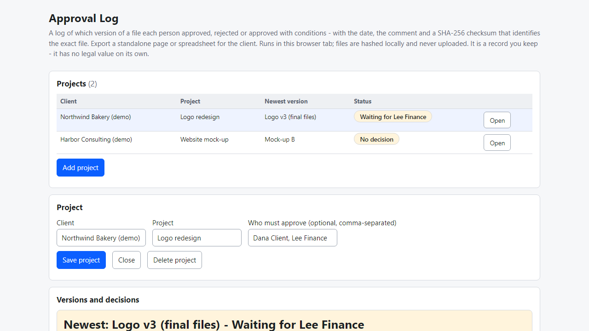
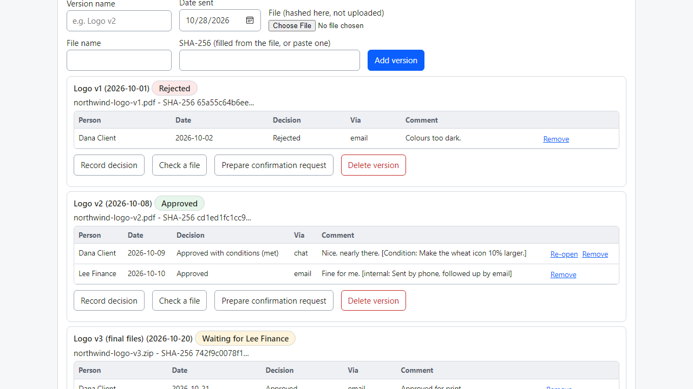
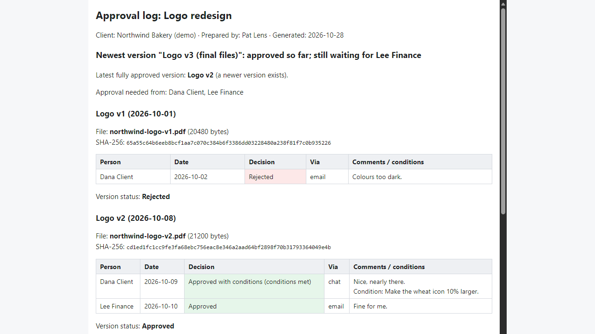

# Approval Log

**record who approved which exact file version (offline)**

Offline browser tool: log approvals, rejections and conditions per file version with SHA-256 checksums, plus a one-file page for your client.

## What it does

**"Which version did you approve?" - "I never approved that."**

Approval Log is a small tool that runs in your browser, offline. For each project you log the versions you send. For each version you record who approved it, rejected it or approved it with conditions, on what date, through which channel and with which words. Each version carries a SHA-256 checksum of the exact file, so the question "which file was that?" has a precise answer.

How it works
1. Open `index.html`. Add a project: client, project, and optionally the people who must all approve.
2. Add each version you send: name, date, and pick the file. The checksum is computed inside your browser; the file is never uploaded.
3. Click "Prepare confirmation request" for a ready text that names the version, the file and the start of the checksum. Copy it and send it yourself.
4. Record each answer: person, date, approved / approved with conditions / rejected, email / chat / call / meeting, their comment, and a private note.
5. Watch the status: approved, rejected, conditions open, or "waiting for Lee" when several people must approve. Mark conditions as met when you have done them.
6. Later, "Check a file": pick the file you hold and see MATCH or DIFFERENT against the recorded version.
7. Download one HTML page for the client (versions, checksums, decisions, comments - never your private notes) or a spreadsheet (.csv). Back up everything as .json.

It also points out: a newer version after the last approval, two versions with the same checksum, decisions on a version with no checksum, a decision dated before the version was sent.

Why offline: client names and files never leave your computer. No account, subscription or server.

## What it does not do

- **It has no legal value on its own.** It is a log you keep and can edit. A checksum shows which file was meant, not who approved it. It does not replace your contract, the client's own emails or messages, or an e-signature service. Not legal advice.
- It does not send emails, collect signatures, host files or let the client comment on a design.
- If you already use a proofing platform that logs approvals, you may not need this.
- Projects are stored in this browser for this file location only. Moving the folder or clearing site data empties it - make a backup (.json).
- Tested in Microsoft Edge on Windows with synthetic data only (34 automated checks, 49 deliberate code breakages all caught). Hashing reads the whole file into memory: very large files may be slow. Not tested with real freelancers, other browsers or phones. No support or updates are promised.

## Get it

$9 one-time on Gumroad: https://asecrier.gumroad.com/l/dtsxi

Product page: https://offline-tools-hub.asecrier.workers.dev/p/approval-log
