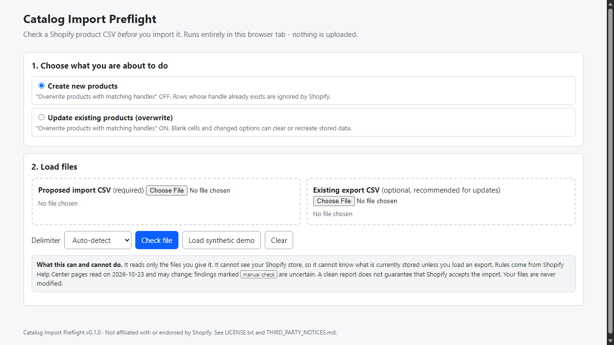
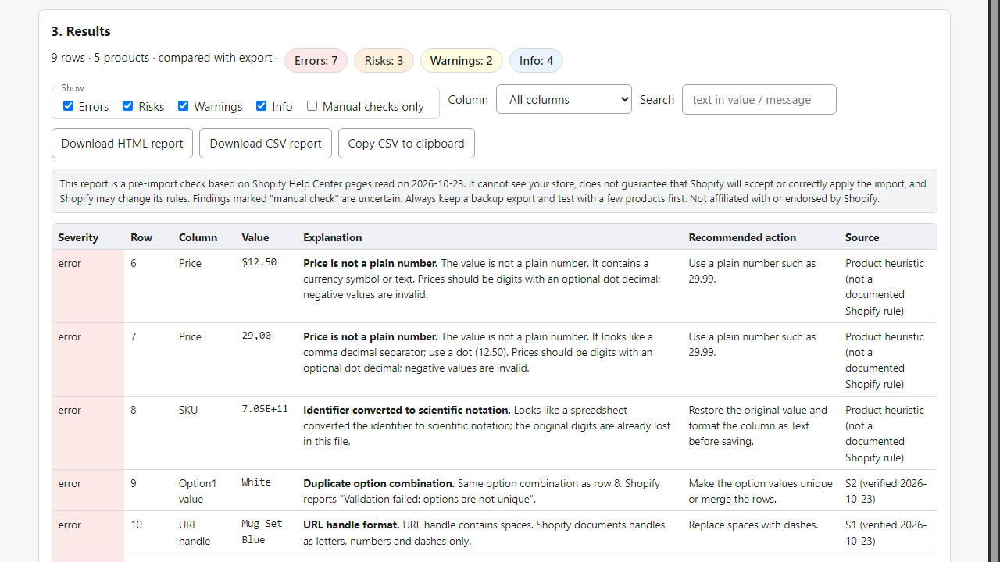

# Catalog Import Preflight

**Shopify CSV overwrite risk checker**

Offline checker for Shopify product CSVs. Compare your file with a store export to see which values a CSV overwrite would blank, recreate or drop.

## What it does

**Importing a product CSV with "Overwrite products with matching handles" can change more than you meant to.** Shopify's own help pages say that a blank cell in a non-required column replaces the stored value with blank, that changing an option value deletes the old variant ID and creates a new one, and that variant columns without the Option1 columns can create a default variant and delete existing variants. Merchants have posted in the Shopify Community about variants and inventory disappearing after such imports.

**Catalog Import Preflight** is a small tool that runs in your browser, offline, and tells you what is wrong or risky in the file *before* you import it.

How it works
1. Open `index.html` from the unzipped folder.
2. Pick *Create* or *Update (overwrite)*.
3. Load your proposed CSV - and, for updates, a fresh export of your current products.
4. Read the findings, filter them, and download an HTML or CSV report.

What it checks (full list with sources in `RULES.md`)
- CSV structure: UTF-8/BOM, CRLF/LF, quotes, commas and multi-line cells, ambiguous delimiters (it asks, it does not guess).
- Current and legacy headers, header spelling, required columns for your chosen mode, variant-column dependencies.
- Variants: repeated handles are normal; duplicate option combinations, missing option names, image-only rows are not mistaken for variants or product updates.
- Prices, inventory numbers, packed dimensions, documented length limits, image URL and position problems, SKUs/barcodes damaged by spreadsheets (scientific notation).
- With an export loaded: blank cells that would replace existing values (the existing value is shown), variants recreated by option changes, exported variants missing from your file, option-name changes, stripped leading zeros. Ambiguous matches are flagged for you to resolve.

Why offline: your product data stays on your computer; the tool contains no server calls, accounts or tracking.

## What it does not do

- It cannot see your Shopify store; without an export it cannot know what is stored.
- It does not fix files, does not connect to Shopify and does not guarantee that Shopify will accept or correctly apply an import. Shopify may change its rules; rules here were read on 2026-10-23.
- Some findings are labelled "manual check" because Shopify's pages do not say what happens.
- Reads CSV only (not .xlsx). Does not verify that image URLs are reachable.
- Not affiliated with or endorsed by Shopify. Free tools that check the structure of Shopify CSVs also exist; this product's difference is the export comparison for overwrite imports.

## Get it

$29 one-time on Gumroad: https://asecrier.gumroad.com/l/catalog-import-preflight

Product page: https://offline-tools-hub.asecrier.workers.dev/p/catalog-import-preflight
