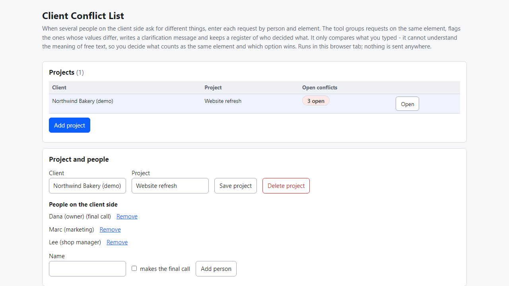
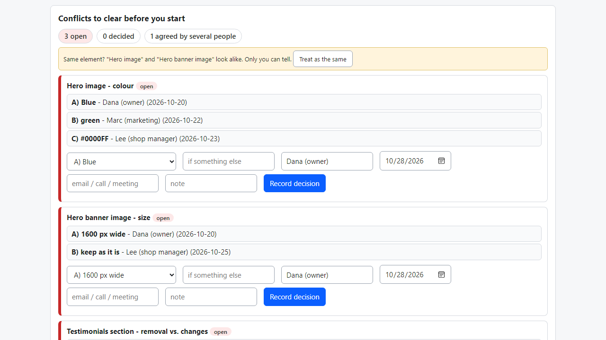
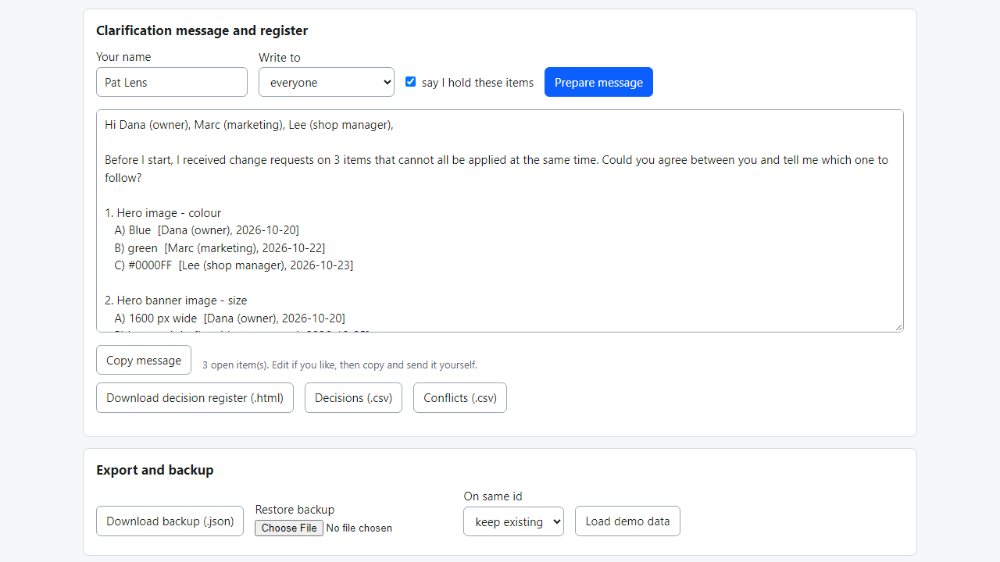

# Client Conflict List

**find contradictory requests from several people at your client, get one answer, log the decision (offline)**

Offline browser tool: enter client requests by person, see which ones contradict, copy a clarification message, keep a register of who decided what.

## What it does

**One person at the client says "make it blue", another says "make it green" - and you find out after you built it.**

Client Conflict List is a small tool that runs in your browser, offline. You enter each change request by person and element ("Hero image - colour: green"). The tool groups requests on the same element, marks the ones where different people asked for different things, and writes a message asking the client to agree before you start.

How it works
1. Open `index.html`. Add a project and the people on the client side (mark who makes the final call, if you know).
2. Add each request: who, date, element, optional attribute, then "change to ...", "remove it" or "keep as it is".
3. "Conflicts to clear" lists every element where two or more people want different things, with lettered options and who asked when. Remove-vs-change by another person is flagged too.
4. If two element names look alike ("Hero image" / "Hero banner image") the tool suggests they may be the same; you decide.
5. "Prepare message": a ready text listing the open conflicts, naming the person with the final call, saying you hold only those items. Copy it and send it yourself.
6. "Safe to start" shows the requests nobody contradicts.
7. When the client answers, record the decision: option, who decided, date, how (email/call), note. If a newer request contradicts it later, the item reopens.
8. Download the decision register as a plain page to attach to an email, decisions or conflicts as .csv, or a backup (.json).

## What it does not do

- It does not understand meaning. It compares what you type: same element + attribute, different values. "Make it pop" vs "tone it down" is a conflict only if you enter them as two values for the same element. "blue" and "#0000FF" count as different values (colour codes, numbers and units like "120 px" / "120px" are matched).
- Which requests really conflict, who has authority and which option wins is your call - you record it.
- It does not send emails, invoice, negotiate or replace a written agreement with your client. Not legal advice.
- Projects are stored in this browser for this file location only. Moving the folder or clearing site data empties it - make a backup (.json).
- Tested in Microsoft Edge on Windows with synthetic data only (automated browser checks, an independent re-check in Python, and deliberate code breakages all caught). Not tested with real freelancers, other browsers or phones. No support or updates are promised.

## Get it

$9 one-time on Gumroad: https://asecrier.gumroad.com/l/lkxzhn

Product page: https://offline-tools-hub.asecrier.workers.dev/p/client-conflict-list
