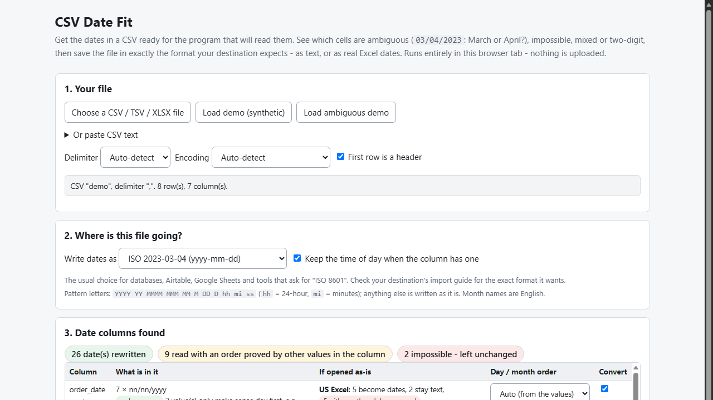
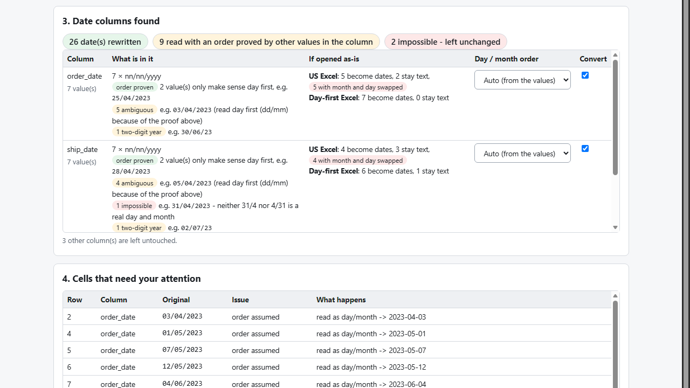

# CSV Date Fit

**fix ambiguous CSV dates (dd/mm vs mm/dd) before Excel or an import gets them wrong (offline)**

Offline browser tool: finds day/month ambiguity, impossible and two-digit dates in a CSV, then saves the format your destination expects - as text or real Excel dates.

## What it does

**Is 03/04/2023 March or April? Your CSV won't tell you. This tool tells you what the file proves and what it doesn't.**

Open a CSV in Excel on a machine whose regional settings differ from the file's, and days 1-12 are silently read as months while days 13-31 stay text: one column, half swapped, half not dates. CSV Date Fit reads the dates, works out the day/month order from the values themselves, and shows every cell it is not sure about - before you save anything.

How it works
1. Open `index.html` (offline, any modern browser). Choose a CSV / TSV / XLSX file or paste text.
2. See each date column: which shapes it holds, whether the order is *proven* (a `25/04/2023` can only be day-first), how many cells are ambiguous, impossible (`31/04/2023`, `29/02/2023`), two-digit-year, time-zoned or before 1900.
3. See what a plain open would do: how many cells a US-style and a day-first Excel would turn into dates, leave as text, or swap.
4. Pick the destination format: ISO `yyyy-mm-dd`, US, day-first, dotted, `04-Mar-2023`, or your own pattern, with or without time.
5. Download an `.xlsx` with real date cells (shown in your format on any regional setting), a CSV with dates as text, and a problem list (row, column, original value, issue).

Careful by design
- When the file does not prove the order, those cells are **not converted** until you choose Day first / Month first for that column.
- A cell that cannot be converted is written back unchanged and listed - never blanked, never guessed.
- Times are kept as written; no time-zone conversion.
- Your data never leaves your computer: no account, no upload, no server.

## What it does not do

- It cannot know the order of a file that doesn't prove it; it asks you.
- No time-zone or daylight-saving conversion. English month names only. Two-digit years follow Excel's 1930-2029 window. Dates before 1900 are text in the .xlsx.
- Excel's free Data > From Text/CSV can also set a column's date order if you already know it; this tool works the order out from the data, lists the doubtful cells and writes the destination format for you.
- Tested with desktop Excel 16 and Microsoft Edge on Windows with synthetic data. Not tested on a US-locale Excel, in LibreOffice, Numbers, Google Sheets or other browsers, nor against any particular import destination. No support or updates are promised.

## Get it

$9 one-time on Gumroad: https://asecrier.gumroad.com/l/nxfpdh

Product page: https://offline-tools-hub.asecrier.workers.dev/p/csv-date-fit
