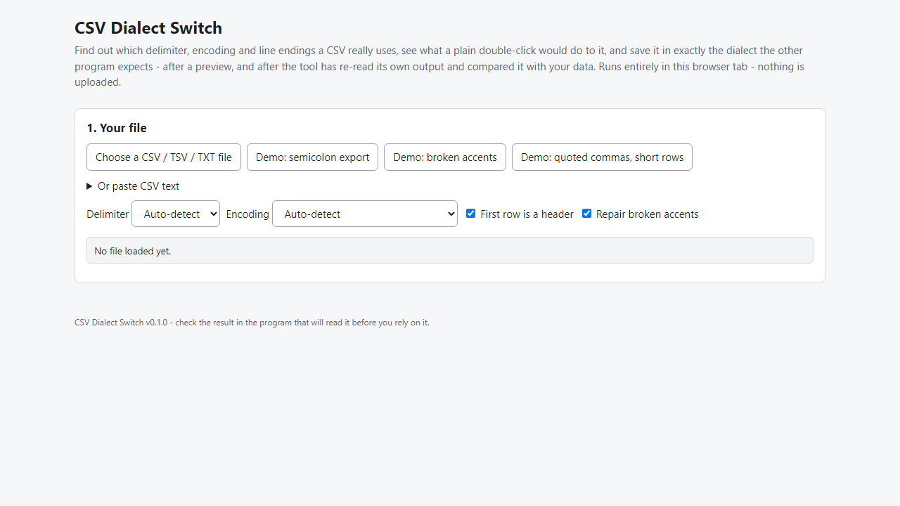
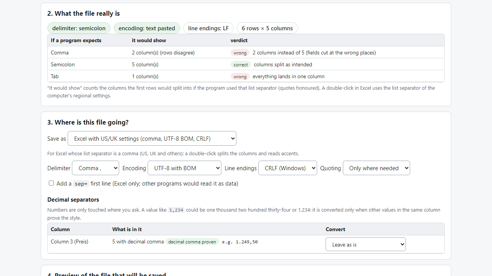

# CSV Dialect Switch

**fix the wrong delimiter, encoding and broken accents in a CSV, with a preview (offline)**

Offline browser tool: detects a CSV's delimiter and encoding, shows what Excel would do, and saves the dialect your import expects - after a verified preview.

## What it does

**A semicolon CSV opened on a comma machine lands in one column. A UTF-8 file without a BOM turns Müller into MĂĽller. This tool shows you before you save.**

Excel splits a double-clicked CSV by the computer's regional list separator, and imports often accept only one separator. Replacing characters by hand breaks quoted fields that contain the delimiter. CSV Dialect Switch reads the file properly, tells you what it is, and writes it again in the dialect you pick.

How it works
1. Open `index.html` (offline, any modern browser). Choose a CSV / TSV / TXT file or paste text.
2. See the detected delimiter (comma, semicolon, tab, pipe), encoding (UTF-8, UTF-16, Windows-1252/1250/1251, ISO-8859-2), line endings and any irregular rows - and a table of how many columns a comma, semicolon or tab program would split the file into.
3. Broken accents such as `Café` (UTF-8 read as Windows-1252 and saved again) are detected and repaired when the repair is exactly reversible.
4. Pick where the file is going: Excel with European settings, Excel with US/UK settings, generic import, TSV, Excel "Unicode Text" style - or set delimiter, encoding (UTF-8, UTF-8 BOM, Windows-1252, UTF-16), line endings and quoting yourself.
5. Optionally convert decimals per column (`1.249,50` <-> `1,249.50`). A value like `1,234` is only converted when other values in the column prove the style.
6. Check the preview (text with highlighted delimiters, and a table). The tool re-reads its own output and tells you whether every cell matches your data.
7. Download the converted file and a change report.

Careful by design
- Cells are written exactly as read, except the decimal conversions and padding you choose. Nothing is trimmed or guessed.
- Characters the chosen code page cannot hold are listed, never dropped silently.
- Your data never leaves your computer: no account, no upload, no server.

## What it does not do

- It does not clean cell content, convert dates, protect IDs, or read/write .xlsx.
- Delimiter detection is a heuristic; when two delimiters fit equally it says so and you choose. A browser cannot read Excel's list separator, so you choose the target.
- Excel's free Data > From Text/CSV can also pick a delimiter and encoding on import; this tool writes the converted file for you, with a preview and verification.
- Tested with desktop Excel 16 (semicolon list separator) and Microsoft Edge on Windows with synthetic data. Not tested on a comma-list-separator Excel, LibreOffice, Numbers, Google Sheets, other browsers, or any particular import destination. No support or updates are promised.

## Get it

$7 one-time on Gumroad: https://asecrier.gumroad.com/l/gwhfoq

Product page: https://offline-tools-hub.asecrier.workers.dev/p/csv-dialect-switch
