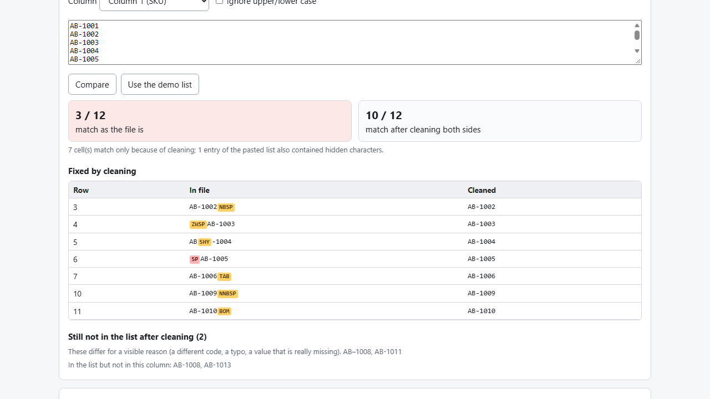
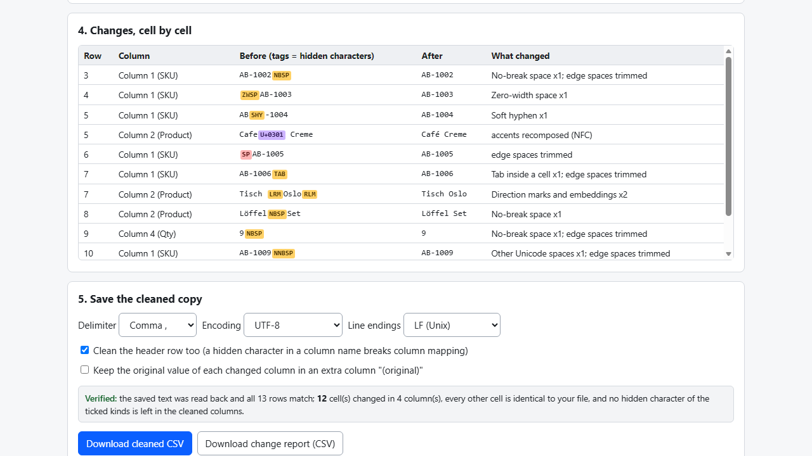

# CSV Ghost Chars

**find and remove the invisible characters that break lookups and imports (offline)**

Offline browser tool: shows the hidden characters (NBSP, zero-width, tabs...) that make identical-looking codes not match, cleans them, and reports every change.

## What it does

**Two product codes look identical, but VLOOKUP says #N/A and the import skips the row. Usually one of them has a character you cannot see.**

A no-break space, a zero-width space, a soft hyphen, a stray tab or a trailing space makes "AB-1002" and "AB-1002" different strings. Excel's TRIM does not remove a no-break space, and none of the formulas touch zero-width characters. CSV Ghost Chars finds them, shows exactly where they are, and saves a cleaned copy.

How it works
1. Open `index.html` (offline, any modern browser). Choose a CSV / TSV / TXT file or paste text.
2. See which hidden characters exist, by kind and by column, with the characters shown as tags inside the value (`AB-1002[NBSP]`, `[ZWSP]AB-1003`).
3. Tick the kinds and columns to clean. Default: no-break and other Unicode spaces, zero-width characters, soft hyphen, direction marks, control characters, tabs, leading/trailing spaces, decomposed accents (NFC). Off by default because they change visible text: look-alike dashes, curly quotes, full-width letters, repeated inner spaces, line breaks inside cells.
4. Optional: paste the list from the other system and see how many codes match before and after cleaning, and which still do not.
5. Review every changed cell (before with tags / after), then download the cleaned CSV and a change report with row, column, original and result.

Careful by design
- Your original file is never modified; the cleaned copy is a new download. Optionally keep each changed column's original value in an extra column.
- Cells without a ticked hidden character are written exactly as read.
- After cleaning, the tool re-reads its own output and verifies it cell by cell.
- Your data never leaves your computer: no account, no upload, no server.

## What it does not do

- It does not read or write .xlsx, convert delimiters/encodings, fix dates or protect leading zeros, or repair broken accents (UTF-8 read as Windows-1252). Other tools do those.
- It cleans the characters listed above; other odd characters are not touched. Zero-width joiners are kept in Arabic, Indic and emoji text.
- It cannot know which values your destination expects; the match check only compares against the list you paste.
- Excel formulas (TRIM + SUBSTITUTE(CHAR(160))) can fix a single known character for free; this tool adds discovery, a before/after view, many kinds at once and a report.
- Tested with Microsoft Edge on Windows with synthetic data, plus an independent Python reference cleaner. Not tested in other browsers, with real exports, or with any particular import destination. No support or updates are promised.

## Get it

$7 one-time on Gumroad: https://asecrier.gumroad.com/l/tfoleb

Product page: https://offline-tools-hub.asecrier.workers.dev/p/csv-ghost-chars
