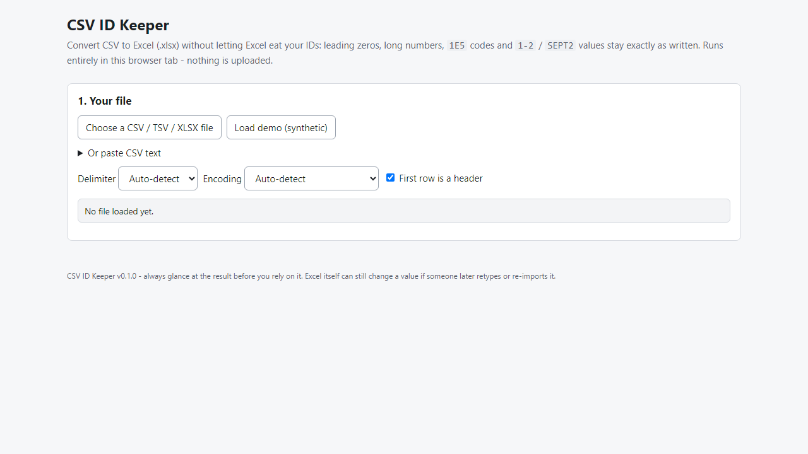
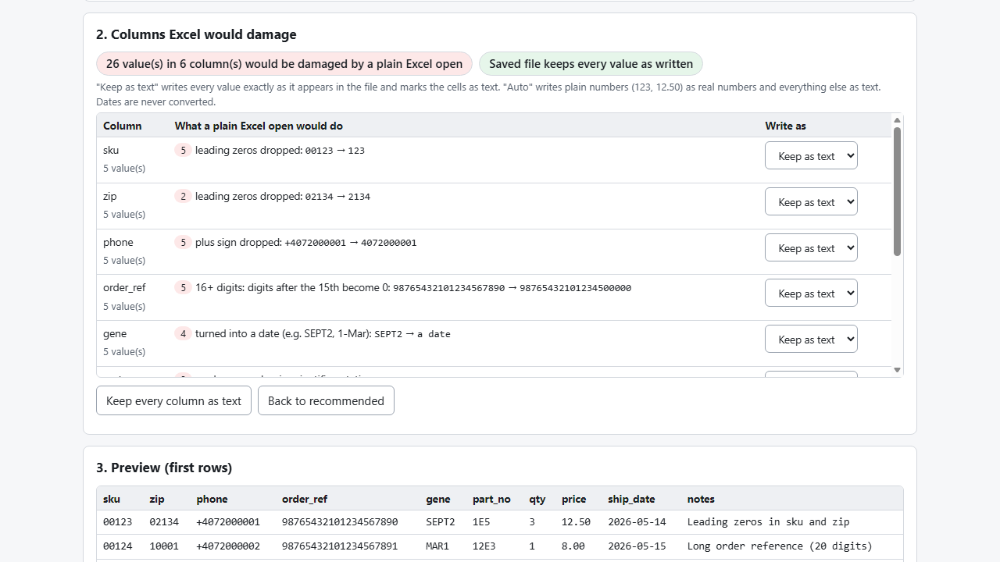

# CSV ID Keeper

**convert CSV to Excel without losing leading zeros, long IDs or codes (offline)**

Offline browser tool: CSV to .xlsx where 00123, 20-digit IDs, 1E5 and 3-4 stay exactly as written, plus a report of what Excel would have damaged.

## What it does

**Excel opens your CSV and rewrites your identifiers. This stops it.**

Double-click a CSV and Excel turns `00123` into `123`, a 20-digit order number into `9.88E+19` (the digits are gone for good), `1E5` into 100000, `3-4` into a date, `SEPT2` into `sept.02`. CSV ID Keeper converts the file to a real `.xlsx` where those cells are stored as text.

How it works
1. Open `index.html` (offline, any modern browser). Choose a CSV / TSV / XLSX file or paste text.
2. See, per column, exactly what a plain Excel open would do, with before -> after examples.
3. Risky columns are set to "Keep as text" automatically; change any column with a dropdown.
4. Download the .xlsx and open it in Excel.

Also
- Reads UTF-8, UTF-16 and Windows-1252; detects comma, semicolon, tab and pipe delimiters.
- Reverse direction: .xlsx to a clean CSV, writing zero-padded formats (`00000`) with their zeros and dates as ISO.
- Reports numbers Excel already stored in scientific notation (those digits cannot be recovered).
- Cells that start with `=`, `+`, `-` or `@` are stored as text, never formulas.
- Optional "Excel-safe" CSV (`="00123"`) for files that will be opened in Excel by hand.
- Your data never leaves your computer: no account, no upload, no server.

## What it does not do

- It cannot recover digits Excel already lost in an .xlsx.
- Only the first sheet of an .xlsx is read; old .xls is not supported; no multi-sheet output or styling beyond a bold, frozen, filtered header row.
- Dates are kept as text, never converted to Excel dates.
- Excel's free "Data > From Text/CSV" can also set a column to Text; this tool saves you doing it by hand and tells you which columns are at risk.
- Tested with desktop Excel 16 and Microsoft Edge on Windows with synthetic data. Not tested in LibreOffice, Numbers, Google Sheets or other browsers. No support or updates are promised.

## Get it

$9 one-time on Gumroad: https://asecrier.gumroad.com/l/jhrlpk

Product page: https://offline-tools-hub.asecrier.workers.dev/p/csv-id-keeper
