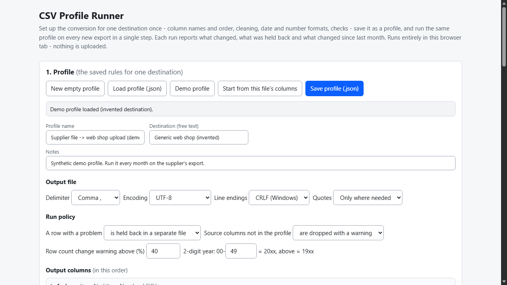
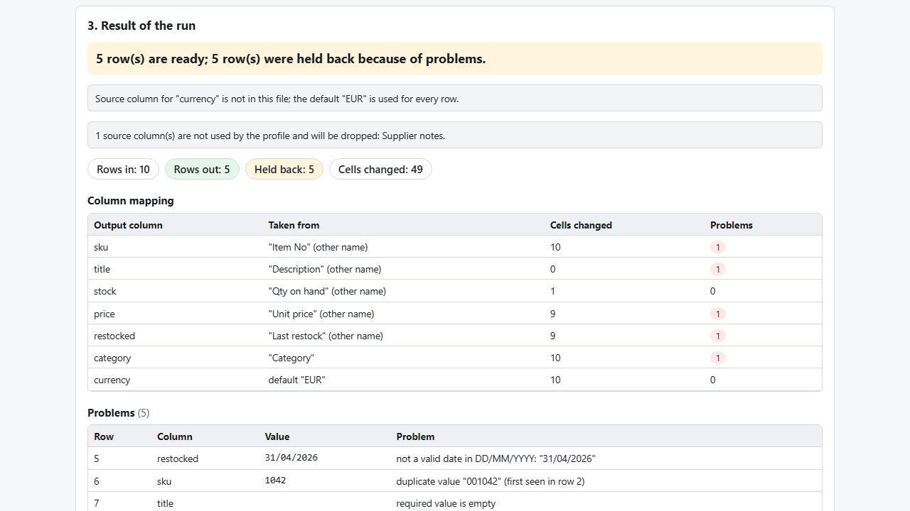

# CSV Profile Runner

**save your monthly CSV fixes as a profile and run them in one step (offline)**

Offline browser tool: save column names/order, cleaning, date/number formats and checks as a profile, then run each new export in one step with a report.

## What it does

**Every month the same export, the same fixes - and one month the supplier renames a column and your import breaks.**

CSV Profile Runner lets you describe the conversion for one destination once, save it as a small JSON profile, and run it on every new file.

What a profile holds
- Output columns in your order, each with the names it may have in the incoming file. Names are matched ignoring case, spaces and punctuation, by name and not by position, so reordered or extra columns do not break the run.
- Per-column rules: remove hidden characters (no-break spaces, zero-width), trim, find/replace, letter case, default for empty cells, number format (1.234,56 to 1234.56, fixed decimals), date format (you state the input order; impossible dates such as 31/04 are refused), zero-padding of all-digit codes, prefix/suffix.
- Checks: required, maximum length, pattern, allowed values, minimum/maximum, unique.
- Output: delimiter, encoding (UTF-8, UTF-8 with BOM, Windows-1252), line endings, quoting.

What you get on every run
1. A clear verdict: ready / rows held back / run stopped (for example a required column was renamed, with a hint which name to add).
2. A column mapping table, every problem with row, column, value and reason, and every changed cell (hidden characters shown as tags).
3. The converted CSV, a separate file with the held-back rows (original layout plus a problems column, so you can fix and re-run), and a run report CSV.
4. A drift check against last month: new or missing source columns, changed column order, large change in row count - using a "last run" record you save into the profile.
5. The output is re-read from its own bytes and compared cell by cell before you download it.

Your data never leaves your computer: no account, no upload, no server. The file you open is never modified.

## What it does not do

- No Excel (.xlsx) reading or writing; CSV/TSV/TXT only.
- It never guesses date order; you state the format in the profile. It does not know your destination's real rules - you encode them in the profile, and a profile only covers the checks you add.
- Free alternatives exist: Excel Power Query or a short script can do much of this; this tool adds a no-code editor, held-back rows, a drift report and a reusable file.
- Running a profile on its own output is not guaranteed to change nothing (a European-decimal rule would misread 4.50).
- Tested with Microsoft Edge on Windows with synthetic data, plus an independent Python re-implementation of the demo profile. Not tested in other browsers, with real supplier or platform files, or against any real import destination. No support or updates are promised.

## Get it

$9 one-time on Gumroad: https://asecrier.gumroad.com/l/bqwwhf

Product page: https://offline-tools-hub.asecrier.workers.dev/p/csv-profile-runner
