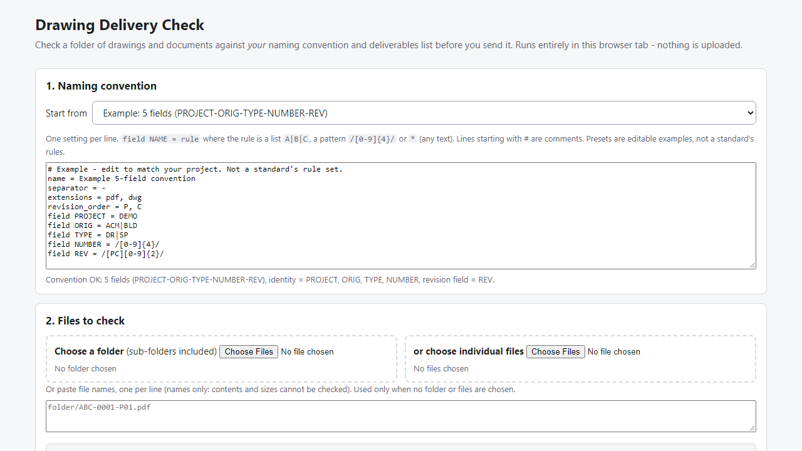
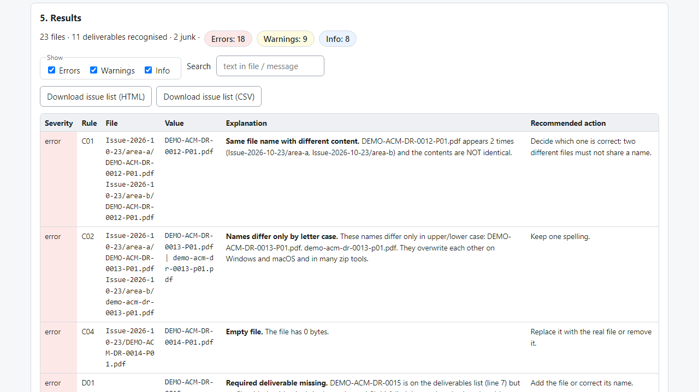

# Drawing Delivery Check

**offline pre-issue check for drawing and document packages**

Offline browser tool: check a drawing folder against your own naming convention and deliverables list, then export an issue list and a transmittal manifest.

## What it does

**Before you send a drawing package, check what is actually in the folder.**

Drawing Delivery Check runs in your browser, offline. You describe your file-naming convention (fields, allowed values, separator, extensions), optionally list the deliverables that must be present, point it at the folder, and it reports what does not match - then writes an issue list and a transmittal manifest of the files that passed.

How it works
1. Open `index.html` from the unzipped folder.
2. Type or pick a naming convention (presets are editable examples).
3. Choose the folder to send (sub-folders included). Optionally load a CSV of required deliverables, revisions and formats.
4. Press **Check delivery**, read the findings, download the issue list (HTML/CSV) and the manifest (printable HTML / CSV).

What it checks (every rule is listed in `RULES.md`)
- **File names** against your convention: field count, allowed values or patterns per field, extension, length, illegal characters, odd spacing, copy/backup markers, temporary files.
- **Required deliverables**: missing drawings, missing formats (e.g. PDF present, DWG missing), revision older or newer than required, files not on the list.
- **Revisions**: gaps in a sequence, superseded revisions still in the package, PDF and DWG at different revisions.
- **Duplicates**: same name in several folders (and whether the content differs), names that differ only by letter case, identical bytes under different names or different revisions, empty files.
- **Manifest**: file name, folder, deliverable, revision, format, size and SHA-256 for every listed file, with your project / transmittal / date / from / to / purpose fields.

Why offline: the files never leave your computer. The tool has no server calls, accounts, subscriptions or daily limits.

## What it does not do

- It does **not open** DWG, PDF, DXF or any drawing, and cannot read title blocks or the revision written inside a file. It checks names, folders, sizes and byte contents only.
- It does **not** claim compliance with ISO 19650 or any other standard, contract or portal. There is no built-in standard: you define the convention. Presets are editable examples.
- It does not rename, fix or move files, and does not send anything. The manifest is a list of what the browser read, not a signed or legally binding record.
- A report with no findings only means the implemented checks found nothing.
- Free tools that validate file names against a standard naming scheme exist; this product's difference is a user-defined convention plus deliverables, revisions, duplicates and a manifest in one offline tool.

## Get it

$29 one-time on Gumroad: https://asecrier.gumroad.com/l/drawing-delivery-check

Product page: https://offline-tools-hub.asecrier.workers.dev/p/drawing-delivery-check
