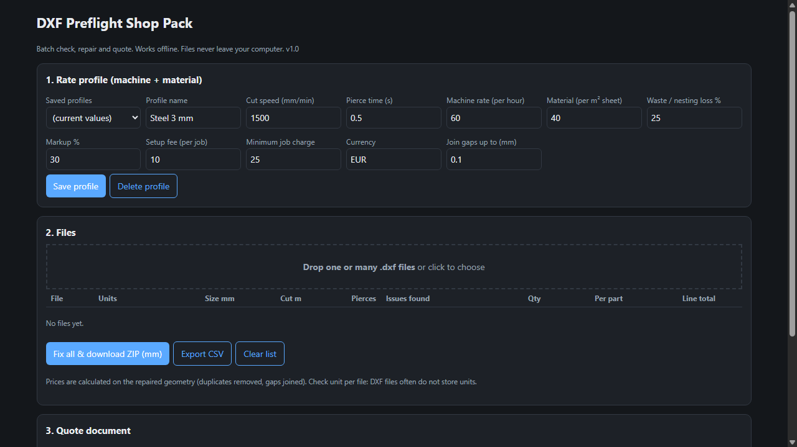

# DXF Preflight Shop Pack

**Batch DXF Check, Repair and Quote Tool**

Offline batch DXF check, repair and quote tool for laser and CNC cutting shops.

## What it does

Quote and prepare many DXF files for laser or CNC cutting in minutes, offline, on your own computer.

Drop a folder of DXF files and get, for each one: size, cut length, pierce count, and the problems found: duplicate lines (double cuts), open contours and suspicious units.

Repair them all in one click: duplicates removed, small gaps joined, output in millimetres as clean LINE/ARC/CIRCLE DXF, downloaded as a ZIP.

Price the whole job with your own rates: cut speed, pierce time, machine rate, material, waste, markup, setup and minimum charge. Save a profile per machine and material.

Print or save a customer quote as PDF with your company name and logo, or export CSV.

Files never leave your computer. No installation: open shop.html in Chrome, Edge or Firefox.

Limits: ASCII DXF only (no DWG), prices are estimates from bounding-box material area and constant cut speed, splines and ellipses become line segments. Check results in your CAM software before cutting. Try the free single-file version first: https://asecrier.github.io/dxf-preflight/

Includes: shop.html, README, license, sample DXF files. Support: contact@proiectrutier.ro

## What it does not do

- Not yet tested: printing the PDF quote, the company logo, real-world shop files and browsers other than the ones used in testing.
- Written for LINE/ARC/CIRCLE-type geometry; check complex CAD files (splines, ellipses, blocks) before relying on the result.
- The quote uses only the rates you enter; it is not a material price list.

## Get it

$29 one-time on Gumroad: https://asecrier.gumroad.com/l/dxf-preflight-shop-pack

Product page: https://offline-tools-hub.asecrier.workers.dev/p/dxf-preflight-shop-pack
