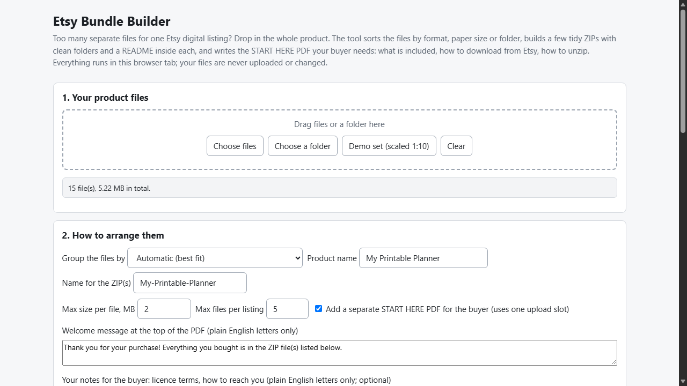
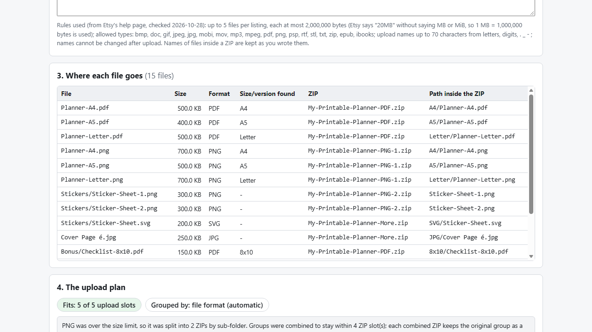

# Etsy Bundle Builder

**sort a big digital product into tidy ZIPs + a buyer guide PDF (offline)**

Offline browser tool: sorts a pile of Etsy product files into a few ZIPs by format or paper size, adds READMEs and a START HERE PDF for your buyer, and verifies it all.

## What it does

**Etsy allows 5 files per digital listing. Your product has 40. And buyers still write "I can't open it".**

Etsy Bundle Builder takes the whole product folder and turns it into what you actually upload:

- **Sorts by meaning, not by size.** Group by file format (PDF / PNG / SVG ...), by paper size or version (A4, A5, Letter, 8x10 ... guessed from the file names), by your own folders, or everything in one ZIP. "Automatic" tries all four and keeps the one that fits Etsy's limits and really groups your files.
- **Clean folders inside each ZIP**, e.g. `A4/Planner-A4.pdf`, plus a `README.txt` that lists every folder and file and the other ZIPs of the purchase.
- **A START HERE PDF for your buyer** (uses one upload slot, optional): what they received, how to download from Etsy in a web browser (the Etsy app cannot download digital files), how to unzip on Windows / Mac / iPhone / Android, which program opens each file type in the product, and your own notes (licence, contact).
- **Listing text** (`listing-text.txt`): a ready "What's included" paragraph with file counts, formats and sizes for your listing description.
- **Applies Etsy's published rules** (checked 2026-10-28): 5 files per listing, 20 MB each, allowed file types, upload names up to 70 characters. Limits are editable in case Etsy changes them. Long product names are shortened so every ZIP name stays valid.
- **Checks what it built**: every ZIP entry is decompressed and CRC-checked, each file matches your original, the exact planned file list is present, upload count / names / sizes are within the rules, the PDF is well formed.

Your files never leave your computer: no account, no upload, no server, originals never modified. Opens in Edge/Chrome by double-clicking index.html.

## What it does not do

- It does not make files smaller and does not split a ZIP that is over the size limit - it warns you. (A splitter such as my other tool, Etsy File Fit, is made for that; it is a separate purchase.)
- It does not upload to Etsy and does not know if Etsy changed its rules after 2026-10-28. The buyer-download steps in the PDF follow Etsy's help pages of that date.
- Paper sizes are guessed from file and folder names; check the table and rename a file if the guess is wrong.
- The START HERE PDF is plain (Courier font, English letters only; accents become "?").
- Free alternatives exist (zip a folder yourself, write the instructions in Word/Canva); this tool makes the sort + instructions + verification repeatable.
- Tested with Microsoft Edge on Windows with synthetic files, plus an independent Python re-check of the output. Not tested in other browsers, with files from real shops, or by uploading to Etsy. The file pickers and folder drag-and-drop were not exercised by the automated tests. No support or updates are promised.

## Get it

$9 one-time on Gumroad: https://asecrier.gumroad.com/l/tsvvvl

Product page: https://offline-tools-hub.asecrier.workers.dev/p/etsy-bundle-builder
