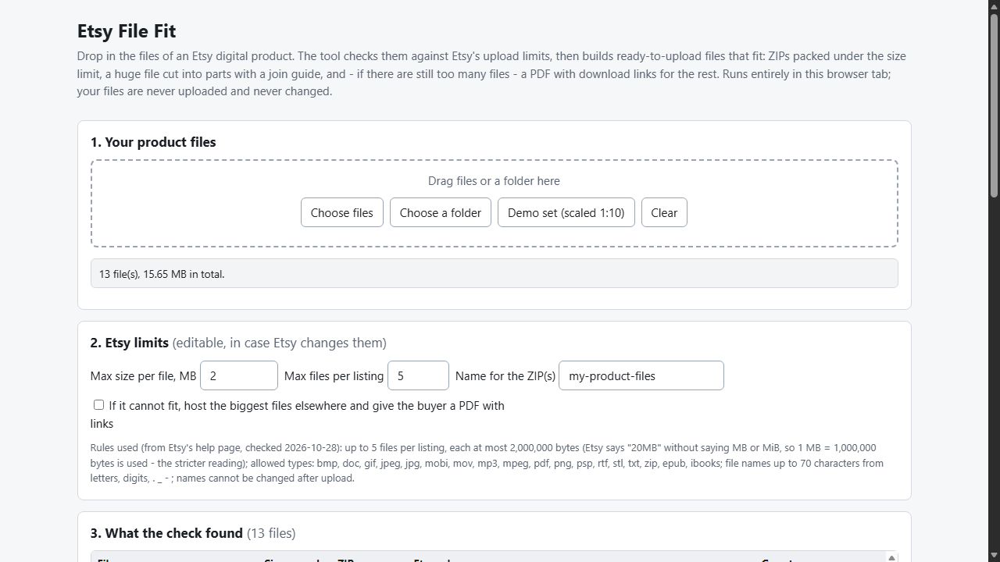
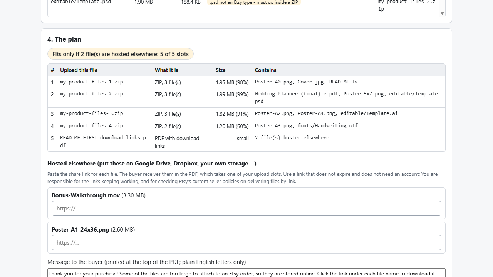

# Etsy File Fit

**make a big digital product fit Etsy's file limits (offline)**

Offline browser tool: checks your files against Etsy's 5-file / 20 MB rules and builds ready-to-upload ZIPs, split parts with a join guide, or a download-links PDF.

## What it does

**Etsy rejects the upload: a file is over 20 MB, you have more than 5 files, or the type isn't allowed. Now what goes where?**

Etsy File Fit takes your product files, works out an arrangement that fits, then builds it.

- Applies Etsy's published digital-listing rules (checked 2026-10-28): up to 5 files per listing, 20 MB each, the list of allowed file types, file names up to 70 characters. The limits are editable in case Etsy changes them.
- Packs files into the fewest ZIPs under the limit. A single allowed file is uploaded as it is; types Etsy does not list (PSD, AI, SVG, DOCX, fonts ...) go inside a ZIP; names Etsy would refuse are renamed.
- A file that cannot fit even on its own is cut into parts (each part a ZIP) with a plain-English join guide and a Windows join script in part 1.
- Still too many files? Optionally move the biggest ones to your own hosting (Google Drive, Dropbox ...) and get a PDF with clickable links as one of your 5 files.
- Re-reads everything it built: every file under the limit, every ZIP entry decompressed and checked, split files re-joined and compared with the original.
- Shows the plan in a table before you build; saves the plan as text.

Your files never leave your computer: no account, no upload, no server, originals never modified. Opens in Edge/Chrome by double-clicking index.html.

## What it does not do

- It does not shrink images or PDFs by lowering quality; lossless ZIP only. JPG/PNG/PDF/video barely compress that way.
- It does not upload to Etsy or any host and cannot check your links. Whether link delivery is allowed for your listing type is for you to check in Etsy's current policies.
- Etsy may change its rules; the tool applies the numbers shown on screen.
- Multi-part files are a burden for buyers (they must join parts); hosting a huge file elsewhere is usually friendlier.
- Free alternatives exist (7-Zip/Windows zip plus a hand-made PDF); this tool adds Etsy-specific checks, the slot plan and verification.
- Tested with Microsoft Edge on Windows with synthetic files, plus an independent Python re-check. Not tested in other browsers, with files from real shops, or by uploading to Etsy. The file pickers and folder drag-and-drop were not exercised by the automated tests. No support or updates are promised.

## Get it

$9 one-time on Gumroad: https://asecrier.gumroad.com/l/jjwbb

Product page: https://offline-tools-hub.asecrier.workers.dev/p/etsy-file-fit
