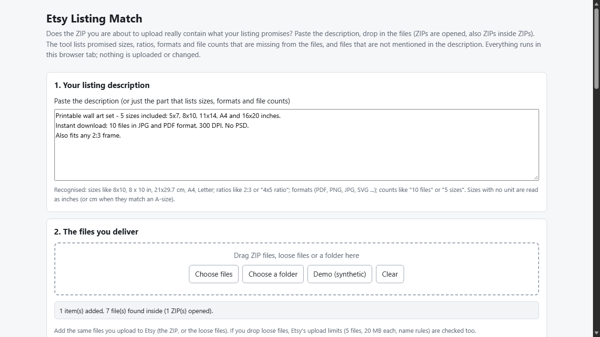
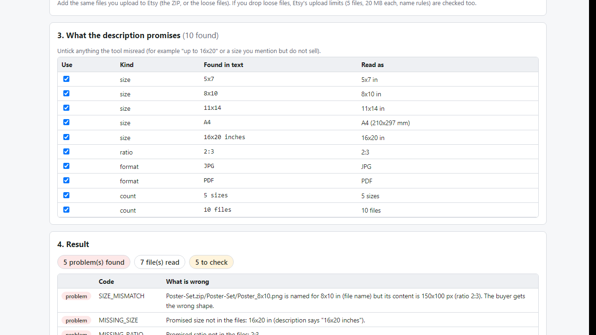

# Etsy Listing Match

**check your ZIP against your listing (offline)**

Offline browser tool: paste your Etsy description, drop your ZIP; it lists promised sizes, formats and file counts that are missing, plus extra or wrong-shaped files.

## What it does

**Your listing says 5 sizes. Does the ZIP really have all 5?**

Paste the description, drop in the files you upload (ZIPs and ZIPs inside ZIPs are opened) and get a list of differences before a buyer finds them:

- **Missing sizes and ratios**: 8x10, 8 x 10 in, 21x29.7 cm, A4, Letter, 2:3 ... read from your text and compared with file and folder names and with the PDF page size.
- **Wrong-shape files**: a file named 8x10 that is really landscape, or an "A4" PDF with Letter pages.
- **Extras**: sizes or formats in the ZIP that the description never mentions; promised formats that are absent.
- **Counts**: "12 files" or "5 sizes" in the text vs what is really delivered.
- **Housekeeping**: .DS_Store and __MACOSX junk, empty files, a .jpg that is really a PNG, duplicates, corrupt ZIPs.
- **Etsy upload limits** for loose files: 5 files, 20 MB each, name rules, allowed types (rules checked 2026-10-28).
- **Reports**: .txt and .csv, plus a "what the files actually contain" line to paste into your description.

You can untick anything the text reader got wrong. Your files never leave your computer: no account, no upload, no server. Double-click index.html in Edge/Chrome.

## What it does not do

- It does not look at the artwork, DPI or quality, and does not read your live Etsy listing.
- Sizes come from text and names (a heuristic); image pixels and PDF page sizes are compared only for shape.
- No encrypted, ZIP64, RAR or 7z archives; PDFs with a compressed page tree show no page size.
- Free alternatives exist (open the ZIP and check by hand); this makes it repeatable and catches shape, format and count slips.
- Tested with Microsoft Edge on Windows with synthetic files plus an independent Python re-check. Not tested in other browsers, with real shop files or on Etsy. No support or updates promised.

## Get it

$7 one-time on Gumroad: https://asecrier.gumroad.com/l/bjugmd

Product page: https://offline-tools-hub.asecrier.workers.dev/p/etsy-listing-match
