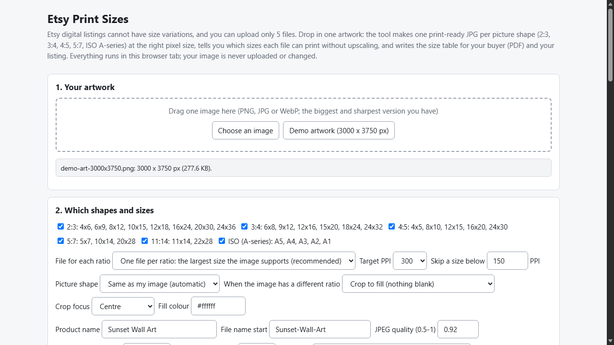
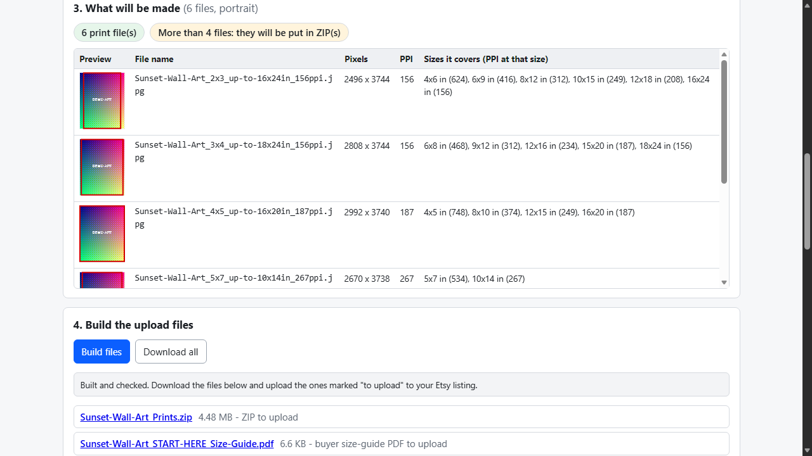

# Etsy Print Sizes

**one artwork to print-ready JPGs for every ratio + size table (offline)**

Offline browser tool: turns ONE artwork into exact-pixel JPGs per print ratio (2:3, 3:4, 4:5, 5:7, 11:14, A-series), with size tables and an Etsy-ready package.

## What it does

**Etsy does not allow size variations on digital listings, and gives you 5 files. Your wall art has 20 sizes.**

Etsy Print Sizes takes one artwork and builds what you actually upload:

- **One print-ready JPG per ratio**: 2:3, 3:4, 4:5, 5:7, 11:14 and ISO A-series (A5-A1). Each file is the largest size your image supports, so smaller sizes of the same ratio print from it.
- **No fake resolution.** Sizes your image cannot support (default minimum 150 PPI, editable) are left out, and each file's real PPI is shown at every size it covers. The tool never upscales.
- **Exact pixels, PPI in the file.** Crop to fill (choose the focus point; thumbnails show the kept area) or fit the whole image with a fill colour. The JPEG header carries the PPI.
- **Size table for your buyer and your listing**: a START HERE PDF (which file for which frame, how to print at actual size, how to download from Etsy and unzip), `listing-text.txt` and `size-table.csv`.
- **Etsy-ready packaging**: files stay under the size limit (quality, then PPI, is lowered if needed and you are told), JPGs go up directly when they fit with the guide, otherwise ZIP(s) with a folder per ratio. Applies Etsy's published rules (checked 2026-10-28): 5 files, 20 MB each, 70-character names. Limits are editable.
- **Checks what it built**: every JPG is decoded again (pixels, ratio, PPI header), ZIPs are CRC-checked, counts, names and sizes are compared with the rules.

Your image never leaves your computer: no account, no upload, no server. Opens in Edge/Chrome by double-clicking index.html.

## What it does not do

- No upscaling or "AI enhancement": a small image gives fewer large sizes. Start from your largest file.
- JPG output only, no embedded colour profile, no bleed or crop marks, no mockups, one artwork at a time.
- It does not upload to Etsy and does not know if Etsy changed its rules after 2026-10-28. Download steps in the PDF follow Etsy's help pages of that date.
- The START HERE PDF is plain (Courier font, English letters only).
- Free alternatives exist (Photoshop, Canva, Affinity, by hand); this tool makes the multi-ratio export, the PPI check and the size table repeatable.
- Tested with Microsoft Edge on Windows with synthetic images, plus an independent Python re-check (Pillow, zipfile). Not tested in other browsers, with photos from real shops, printed on paper or uploaded to Etsy. Browser memory limits very large images. No support or updates are promised.

## Get it

$9 one-time on Gumroad: https://asecrier.gumroad.com/l/ceiprq

Product page: https://offline-tools-hub.asecrier.workers.dev/p/etsy-print-sizes
