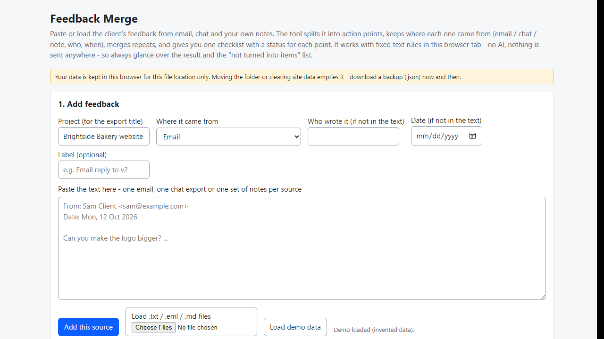
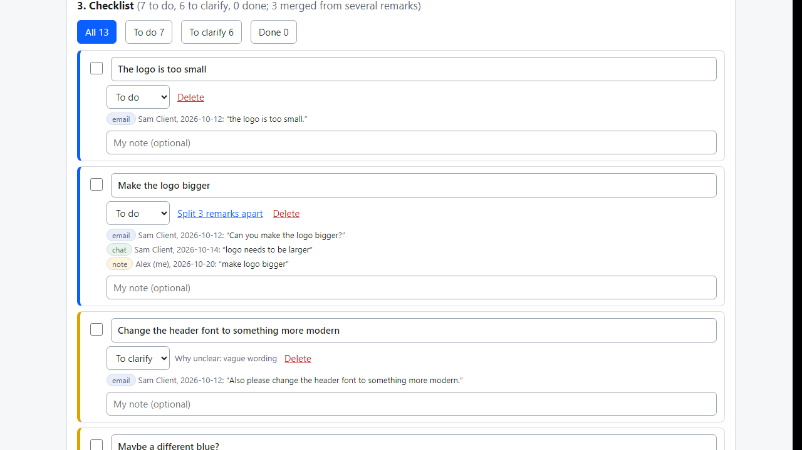
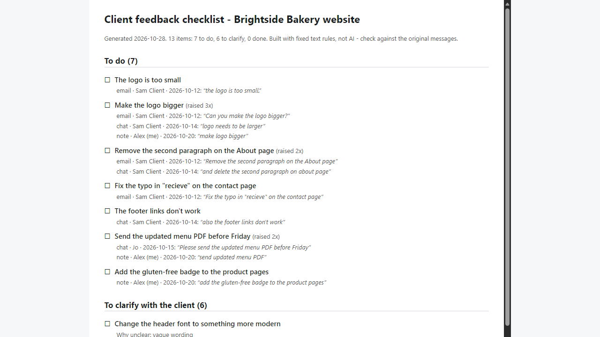

# Feedback Merge

**client feedback from email, chat and notes into one source-tracked checklist (offline)**

Offline browser tool: paste client emails, chats and call notes; get one checklist with each point's source, merged repeats and a to-clarify list.

## What it does

**The client's feedback is in an email, three WhatsApp messages and your call notes - and you still have to merge it into one list.**

Feedback Merge runs in your browser, offline. Paste or load the pieces; it cuts them into action points, remembers where each came from (email, chat or note - who wrote it, when), merges repeats, and keeps questions and vague remarks apart in a "to clarify" list.

How it works
1. Open `index.html`. Choose Email, Chat or My own notes, paste the text (or load a .txt / .eml file), press Add. Repeat for each source.
2. Emails: From / Date / Subject lines are read; quoted replies, "On ... wrote:" blocks and signatures are skipped. Chats: WhatsApp (iOS and Android), ISO-time and Slack-style lines give author and date per message. Notes: one remark per line.
3. The checklist shows each point with every source it was raised in ("raised 3x": email, chat, note), with the original wording quoted. Tick points done, change status (To do / To clarify / Done), edit wording, add your own note, split a merged point, add points by hand.
4. A "not turned into items" list shows what the rules did not see as a request (praise, context) so nothing disappears silently; promote anything you need.
5. Export the checklist as Markdown (with checkboxes and sources), a CSV spreadsheet, or a standalone HTML page; back up and restore as JSON.

Details
- Points that look alike but differ in a number, colour or opposite word (left/right, bigger/smaller, add/remove) are not merged and get a note.
- Ambiguous dates such as 03/04/2026 are shown as written, never guessed.
- A demo with invented data is built in.

Why offline and rule-based: client names and messages never leave your computer, and the result is the same every time. No account, subscription, server or AI service.

## What it does not do

- It does not understand meaning. It uses fixed rules (request verbs, need words, question marks, vague words, similar wording). Unusual phrasing can be missed or a comment taken for a request; "the logo is too small" and "make the logo bigger" are NOT recognised as the same point. Always glance over the checklist and the "not turned into items" list.
- English only. It does not read screenshots, PDFs, attachments, voice notes or video comments with time-codes.
- It does not decide whether two requests contradict each other, does not track scope/revision limits, and does not send anything. Not legal or contract advice; it does not replace the client's approval.
- Data is stored in this browser for this file location. Moving the folder or clearing site data empties it - make a backup (.json).
- Tested in Microsoft Edge on Windows with invented data only (46 automated checks, 33 deliberate code breakages all caught). Accuracy on real client messages is unknown. Not tested with other browsers or phones. No support or updates are promised.

## Get it

$9 one-time on Gumroad: https://asecrier.gumroad.com/l/bsrfya

Product page: https://offline-tools-hub.asecrier.workers.dev/p/feedback-merge
