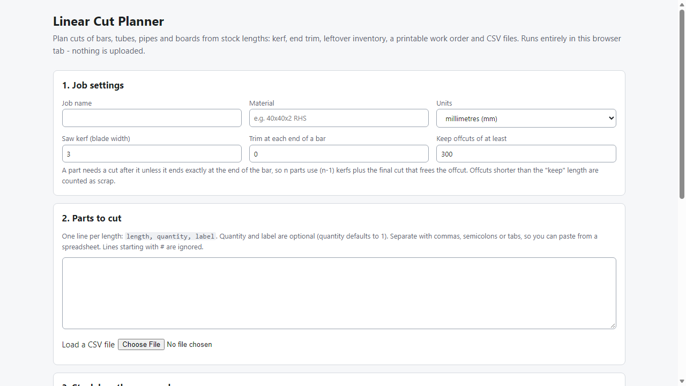
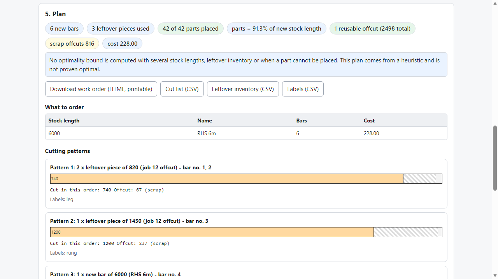

# Linear Cut Planner

**offline cutting plans for bars, tubes and boards**

Offline browser tool: plan cuts from stock lengths with kerf, trim and leftover inventory; get a printable work order and CSV cut list, labels and leftovers.

## What it does

**Plan the cuts, know what to order, keep track of the leftovers.**

Linear Cut Planner runs in your browser, offline. Enter the parts you need (length, quantity, label), the stock lengths you can buy (optionally with prices), your saw kerf and end trim, and the pieces you already have. It shows how to cut each bar, what to order, and writes a printable work order and CSV files.

How it works
1. Open `index.html` from the unzipped folder.
2. Paste or load your parts, stock lengths and (optionally) leftover pieces; millimetres or inches (fractions like 12 3/4 work).
3. Press **Plan cuts**.
4. Read the plan, print the work order, and download the cut list, labels and leftover CSV. Load the leftover CSV into the next job.

What it does
- **Kerf and end trim** modelled explicitly (n parts use n-1 kerfs plus the cut that frees the offcut; trim comes off both ends).
- **Several stock lengths, optional prices, optional quantity limits:** it tries different mixes and re-sizes bars to the cheapest stock that holds their parts.
- **Leftover inventory** used first, never beyond its quantity; the leftover CSV lists unused pieces plus reusable offcuts in the same format, ready for the next job.
- **Work order:** identical bars grouped ("5 bars cut like this"), cut order, offcut marked keep/scrap, proportional drawing. Also cut list CSV (with position from the start of the bar) and labels CSV.
- **Honest about quality:** the plan is a heuristic. The tool shows a lower bound on the number of bars and says "proven optimal" only when that is proven (bound met, or exact solver for jobs of up to 12 pieces). With several lengths or inventory it says no bound is computed. Parts that cannot be cut are listed, never dropped.
- Deterministic: the same input always gives the same plan.

Why offline: your cut lists never leave your computer. No server calls, accounts, subscriptions or row limits.

## What it does not do

- Not a 2D sheet nesting tool; no mitre or angle cuts; no grain, defects or saw-specific rules; no saw or CAM integration.
- It does not know your real blade width: measure your kerf. A plan is a planning aid; check it before cutting expensive material.
- It is a heuristic for larger jobs and is not guaranteed optimal.
- Tested with synthetic jobs on Microsoft Edge only (see TEST_REPORT.md); not tested on real shop jobs or other browsers.
- Free tools that do the core packing already exist, including free offline ones; this product adds the leftover inventory round trip, the work order and labels, price-aware stock choice and the honest optimality statement.

## Get it

$29 one-time on Gumroad: https://asecrier.gumroad.com/l/linear-cut-planner

Product page: https://offline-tools-hub.asecrier.workers.dev/p/linear-cut-planner
