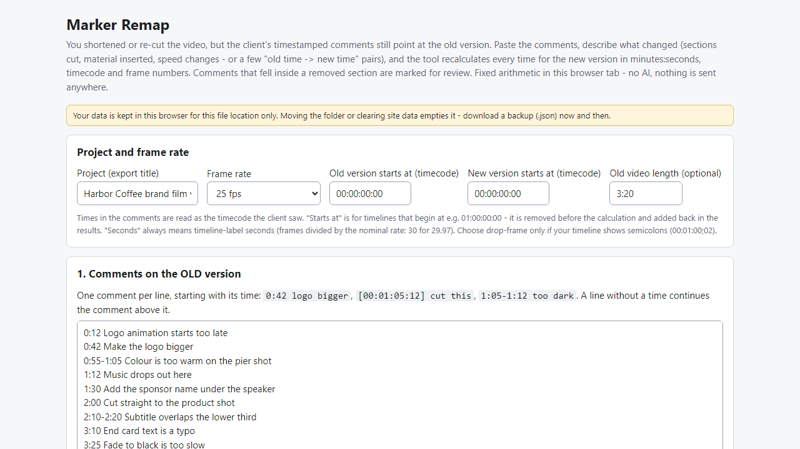
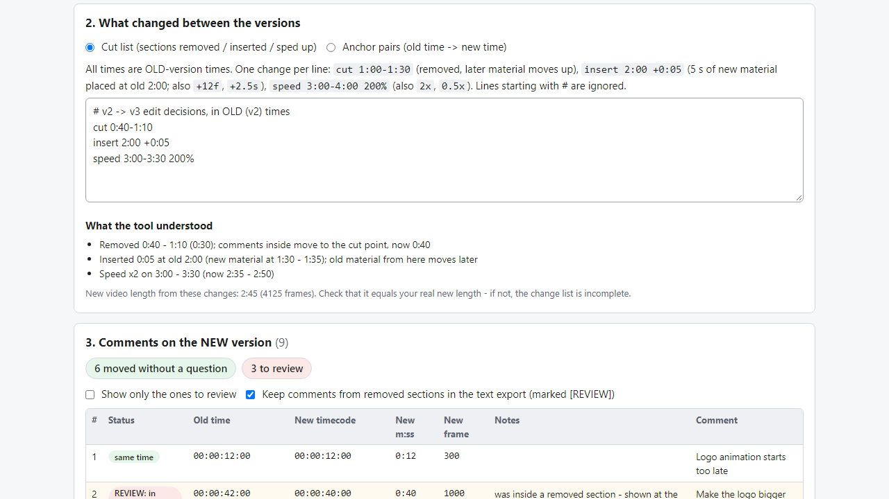
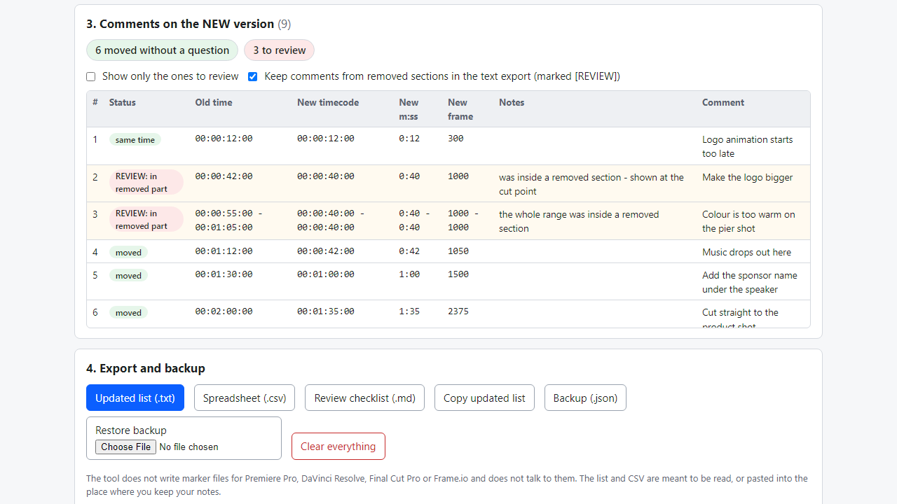

# Marker Remap

**move client video comments to the new cut: recalculate timecodes after cuts, inserts and speed changes (offline)**

Offline browser tool: after you re-cut a video, enter the cuts/inserts/speed changes and get every old comment time recalculated (timecode, m:ss, frames).

## What it does

**You shortened the video. The client's comments still say "0:42", "1:05-1:12", "2:00" - for the old version. Which of them are still where they were, and which fell into a section you cut?**

Marker Remap runs in your browser, offline. Paste the comments on the old version (one per line, time first). Then describe what changed, in old-version times:
- a cut list: `cut 1:00-1:30`, `insert 2:00 +0:05` (also +12f, +2.5s), `speed 3:00-4:00 200%` (also 2x, 0.5x) - or
- anchor pairs: `1:05 -> 0:52` for moments you can find in both versions; times between pairs are interpolated, equal new times mean a removed section.

You get a table with, for every comment, the old time, the new timecode, the new m:ss, the new frame number and notes. Comments that fell inside a removed section are placed at the cut point and marked REVIEW, as are ranges that lose a section, comments past the old video length and times outside your anchor pairs. If you give the old length, the tool shows the resulting new length so you can check your change list adds up to your real cut.

Details
- Frame rates: 23.976, 24, 25, 29.97 (non-drop and drop-frame), 30, 50, 59.94 (non-drop and drop-frame), 60. Timelines that start at 01:00:00:00 are supported. Speed changes are rounded to the nearest frame and noted.
- Order of lines does not matter; overlapping cuts are merged and you are told; two speed changes on the same stretch are refused.
- Export: updated list (.txt, in new-time order, REVIEW rows marked), spreadsheet (.csv, formula-safe), review checklist (.md), copy to clipboard, JSON backup.
- No install, no account, no server, no AI. Fixed arithmetic.

## What it does not do

- It cannot see your video. If the change list does not match what you really did, the new times are wrong - spot-check a few. It does not find a shot that was moved to another place in the film (anchor pairs must keep the order of scenes).
- It does not write marker files for Premiere Pro, DaVinci Resolve, Final Cut Pro or Frame.io and does not connect to them. It does not read review-site exports; English-style text lines only.
- A comment inside a removed section is only marked for review; whether it still applies is your decision.
- Data stays in this browser for this file location - make a backup (.json).
- Tested in Microsoft Edge on Windows with invented data only (40 automated checks, 43 deliberate code breakages all caught, arithmetic cross-checked by an independent implementation). Not tested on real projects, other browsers or phones. No support or updates are promised.

## Get it

$9 one-time on Gumroad: https://asecrier.gumroad.com/l/pghyb

Product page: https://offline-tools-hub.asecrier.workers.dev/p/marker-remap
