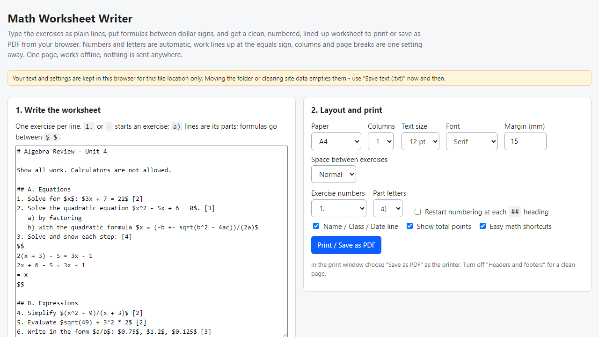
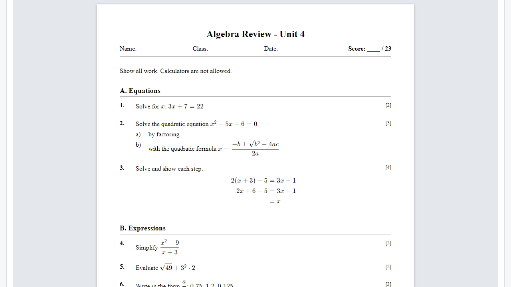
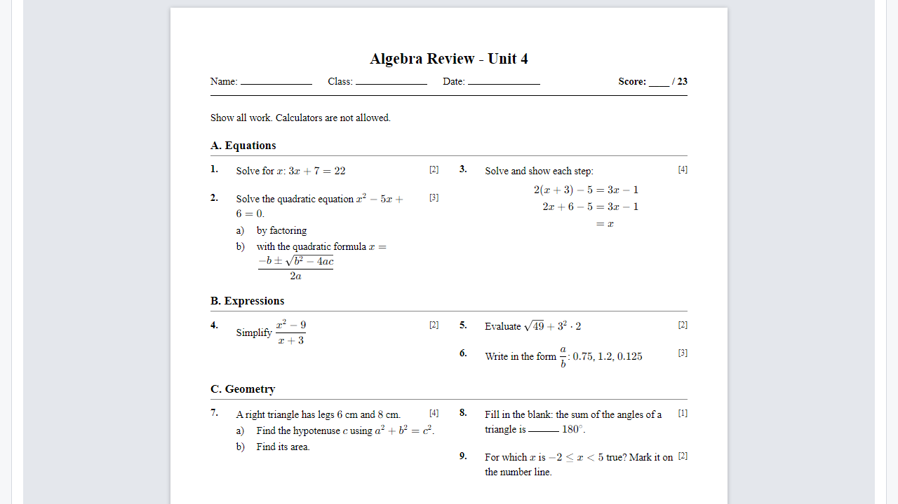

# Math Worksheet Writer

**plain-text exercises to a printable worksheet with formulas (offline)**

Offline browser tool for maths/science teachers: write exercises in plain text with formulas, get an auto-numbered, aligned worksheet to print or save as PDF.

## What it does

**You know the exercises. Getting them onto a clean page with fractions, roots, lettered parts and equations that line up is the slow part.**

Math Worksheet Writer is one page that runs in your browser, offline. Type the worksheet as plain lines:
- `1. Solve $x^2 - 5x + 6 = 0$ [3]` starts an exercise - numbers are automatic whatever you type, `[3]` is the points (the total is added up in the header);
- indented `a)` lines are its parts, lettered automatically;
- formulas go between dollar signs and are drawn by KaTeX (real LaTeX maths: fractions, roots, sums, matrices...). Easy shortcuts also work: `sqrt(x+1)`, `(x+1)/(x-1)`, `x^(n+1)`, `<=`, `+-`, `pi`, `90 deg`;
- lines between two `$$` lines are lined up at the equals sign automatically - handy for worked steps;
- `## Section` headings, `______` blanks, `---` for a new page.

Then choose A4 or US Letter, 1-3 columns, text size, serif or sans, margins, number and letter styles, optional Name / Class / Date line, and click Print / Save as PDF in your browser. A formula the tool does not understand is shown in red where it stands and listed with its line number. Save your text as a .txt file to reuse or share.

No install, no account, no server, no AI. Fonts and formula engine are bundled in the folder.

## What it does not do

- No answer keys, test variants, random problem generation, graphs, pictures or tables, and no space for solving under each exercise.
- It does not read or write Word, Google Docs or LaTeX files.
- Page breaks are decided by your browser's print window; exercises are kept together where they fit. Check one printout before you copy a class set.
- Real printing / Save as PDF was NOT tested automatically - only the print stylesheet rules were checked. Tested in Microsoft Edge on Windows with invented data only (37 automated checks, 42 deliberate code breakages all caught). Not tested in other browsers, on phones or with real classroom material. No support or updates are promised.
- Text and settings are kept in this browser for this file location - save a .txt now and then.
- Free alternatives exist (Word equation editor, Overleaf, Google Docs add-ons); this is a quicker, offline, worksheet-shaped option, not a replacement for them.

## Get it

$9 one-time on Gumroad: https://asecrier.gumroad.com/l/wyqqmo

Product page: https://offline-tools-hub.asecrier.workers.dev/p/math-worksheet-writer
