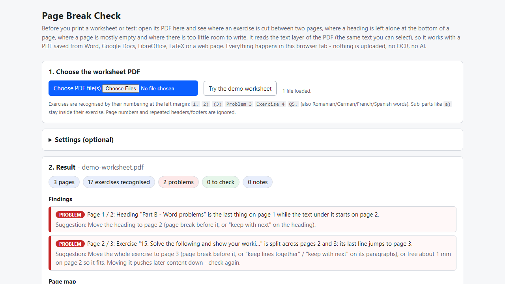
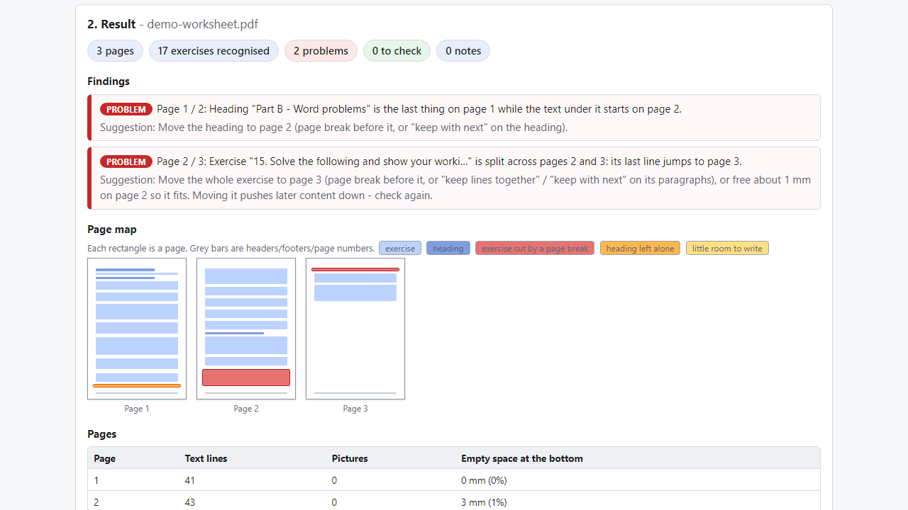
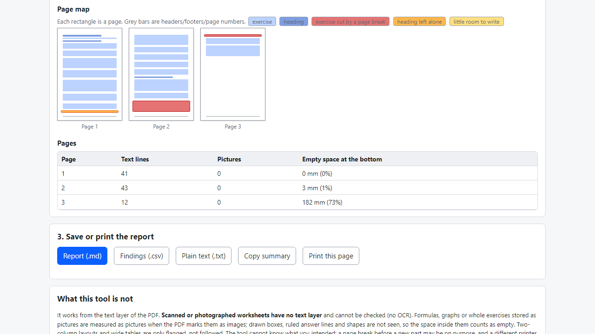

# Page Break Check

**find exercises cut between pages and headings left alone before you print a worksheet (offline PDF checker)**

Offline browser tool: open a worksheet PDF and see which exercises are split across pages, which headings sit alone at the bottom, and where pages are mostly empty.

## What it does

**You print 30 copies and exercise 7 starts at the bottom of page 1 and ends on page 2. Or "Part B" sits alone at the foot of a page with its exercises on the next one.**

Page Break Check runs in your browser, offline. Choose the PDF of your worksheet or test (saved from Word, Google Docs, LibreOffice, LaTeX or a web page). The tool reads the text layer of the PDF and reports, page by page:
- **Exercises cut between pages** - found by their numbering (`1.`, `2)`, `(3)`, `Problem 3`, `Exercise 4`, `Q5.`, also Romanian / German / French / Spanish words). It tells you whether only the first lines stay at the bottom, the last lines jump to the next page, or the exercise is cut in the middle, and whether the break falls between sub-parts (a / b).
- **Headings left alone** at the bottom of a page (a larger font, "Part B", "Section 2", capitals) while their text starts on the next page.
- **Empty space** at the bottom of a page, a **nearly empty last page**, a page without text.
- Optional **room to write**: set a minimum in millimetres and see exercises followed by less space than that.
Every finding comes with a suggestion for your source document (page break before, "keep lines together", "keep with next"). A page map shows each page with the cut exercises in red and lonely headings in orange.

Details
- Several PDFs at once; page numbers and repeated headers/footers are ignored; pictures that the PDF marks as images are measured as blocks; settings for the exercise pattern (including your own regular expression), the number of stranded lines, the header/footer zone.
- Export: report (.md), findings (.csv, formula-safe), plain text (.txt), copy summary, print the result page.
- No install, no account, no upload, no OCR, no AI. Fixed rules. Includes Mozilla pdf.js (Apache-2.0).

## What it does not do

- **Scanned or photographed worksheets have no text layer: they cannot be checked** (no OCR); the tool says so. Formulas or exercises stored as pictures are measured only as pictures; drawn boxes, ruled lines and shapes are not seen, so the space inside them counts as empty.
- Two-column layouts and wide tables are flagged, not followed. It cannot know your intention, and another printer or font may paginate differently - check the PDF you will print.
- It does not edit or repair the PDF and does not read Word files directly (save as PDF first).
- Tested in Microsoft Edge on Windows with invented PDFs only (54 automated checks, 80 random worksheets matched against an independent layout engine, 37 deliberate code breakages all caught). Not tested on real teacher files, other browsers or phones. No support or updates are promised.

## Get it

$9 one-time on Gumroad: https://asecrier.gumroad.com/l/rkhkp

Product page: https://offline-tools-hub.asecrier.workers.dev/p/page-break-check
