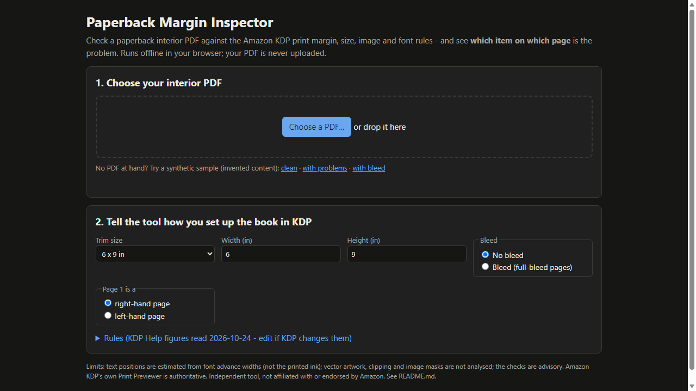
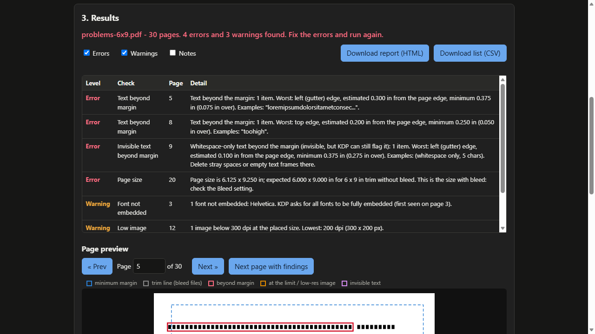
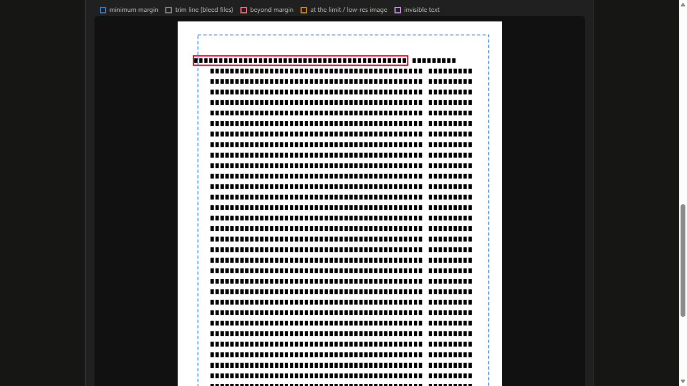

# Paperback Margin Inspector

**find what KDP flags in your interior PDF**

Offline tool: check a paperback interior PDF for margin, gutter, page-size, image and font problems and see exactly which item on which page is the cause.

## What it does

**KDP says "text outside the margins" - but which text, on which page?**

Authors keep reporting that KDP rejects a print-ready PDF for margin or gutter errors even though their layout program shows margins at or above the minimum. Amazon's own help page lists the usual causes: hidden spaces, stray characters or empty text boxes beyond the margin, italic text that overhangs its box, fonts that are not embedded, low-resolution images. Paperback Margin Inspector looks for exactly these in the PDF itself and shows you the page, the distance and a marked-up preview.

Runs in your browser, offline. Your PDF is never uploaded.

How it works
1. Open `index.html` from the unzipped folder.
2. Choose your interior PDF. Set the trim size, bleed yes/no, and whether page 1 is a right-hand page.
3. Read the findings. Click a row to see the page with the minimum-margin box and coloured boxes around the offending items.
4. Fix it in your layout program, export again, check again. Download an HTML report or CSV if you want a record.

What it checks
- **Text against the margins of each page**: the inside (gutter) margin depends on page count (0.375 in for 24-150 pages up to 0.875 in for 701-828) and moves from the left of right-hand pages to the right of left-hand pages; outside, top and bottom minimums are 0.25 in (0.375 in with bleed).
- **Invisible text**: whitespace-only strings drawn beyond the margin, which KDP's help says can trigger a margin flag.
- **Overhang allowance**: near-misses (italics, serifs) are shown as warnings instead of errors; you set the allowance.
- **Page size** against trim (with or without bleed), with a hint when the size matches the other bleed setting; **page count** 24-828.
- **Images**: effective resolution at the placed size (default 300 dpi).
- **Fonts** not embedded.
- All rule values are editable (defaults: KDP Help figures as read on 2026-10-24), so you can follow a rule change.

## What it does not do

- It does **not** fix or edit your PDF and does not convert Word/InDesign files.
- Text positions are **estimates** from font advance widths, not printed ink, and may differ from what KDP's checker measures. Vector artwork, clipping and masks are not analysed.
- **Amazon's own Print Previewer is authoritative.** "No findings" is not a guarantee that KDP will accept a file. Rules may have changed since 2026-10-24.
- Interior files for KDP paperbacks only: no covers/spines, no hardcover, no other printers' rules.
- Tested only on synthetic PDFs and one PDF printed by Edge, on Microsoft Edge only (see TEST_REPORT.md); not tested on real manuscripts, not cross-checked against a KDP upload.
- Free tools already check page size, and at least one free cloud checker covers fonts and image resolution; this product adds the page-by-page content check (recto/verso margins, invisible whitespace, overhang allowance), an annotated preview, and works offline.
- Independent product: not affiliated with or endorsed by Amazon.

## Get it

$19 one-time on Gumroad: https://asecrier.gumroad.com/l/paperback-margin-inspector

Product page: https://offline-tools-hub.asecrier.workers.dev/p/paperback-margin-inspector
