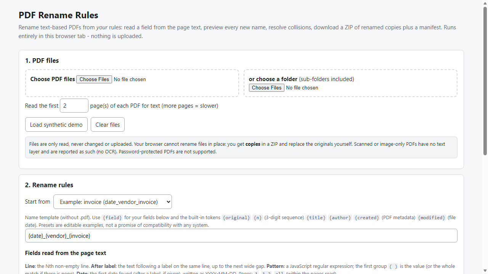
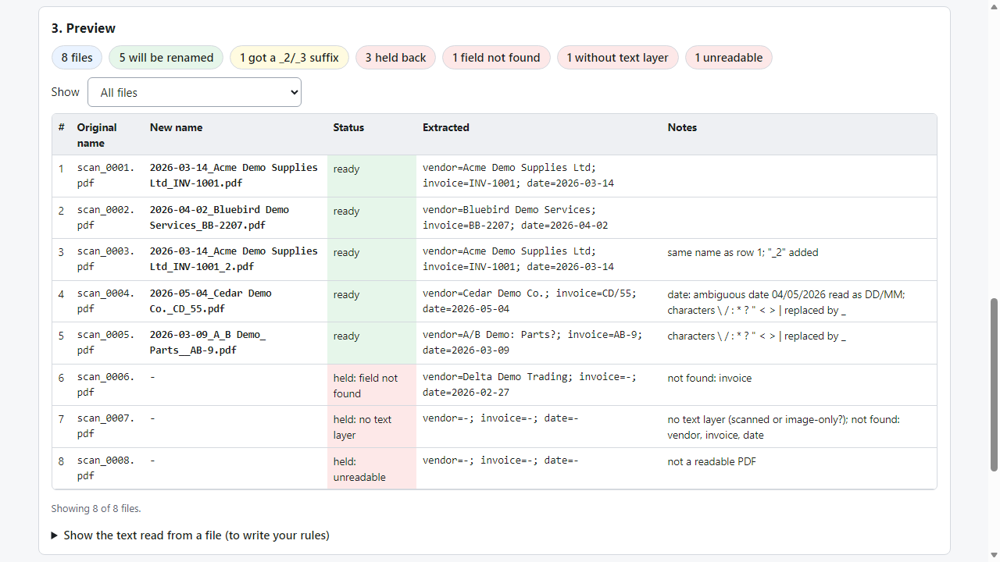

# PDF Rename Rules

**offline batch rename of text-based PDFs**

Offline browser tool: read fields from PDF text, build names by your template, preview every new name, get a ZIP of renamed copies plus a manifest.

## What it does

**Rename a pile of PDFs by what is inside them - and see every new name before you commit to it.**

PDF Rename Rules runs in your browser, offline. You pick PDFs (or a folder), tell it where to find a value in the page text - a line, the text after a label such as "Invoice No", a pattern, or the first date - and write a name template like `{date}_{vendor}_{invoice}`. It shows a preview of every proposed name with a status, resolves duplicates the way you choose, and gives you a ZIP of renamed copies plus a manifest (old name -> new name).

How it works
1. Open `index.html` from the unzipped folder.
2. Add your PDFs. Start from an example rule set and edit it (a "show the text read from this file" panel helps you write the rules).
3. Read the preview: ready / unchanged / held, with notes.
4. Download the ZIP of copies and the manifest (CSV or printable HTML). Replace your originals yourself once you are happy.

What it does
- Reads the text layer of the first pages of each PDF (bundled Mozilla pdf.js).
- Fields: line number, text after a label, regular-expression pattern, first date found (normalised to YYYY-MM-DD; ambiguous dates like 04/05/2026 follow the day-first or month-first setting you choose and are flagged).
- Template tokens: your fields plus original name, sequence number, PDF title/author/creation date, file modified date.
- Cleans names (illegal characters, reserved Windows names, trailing dots, length limit) and tells you what it changed.
- Statuses: ready, unchanged, held (field not found, no text layer, unreadable, collision, empty name). Choose whether missing fields hold the file back or use a fallback text.
- Collisions: add `_2`, `_3` in list order, or keep the first and hold the rest. Nothing is overwritten.
- Rule sets as JSON text you can keep. Synthetic sample PDFs and a sample rule set included.

Why offline: the PDFs never leave your computer. No server calls, accounts, subscriptions or quotas.

## What it does not do

- **It cannot rename your originals in place** - a web page cannot do that. You get copies in a ZIP.
- **No OCR.** Scanned or image-only PDFs have no text layer; they are listed as "no text layer" and held. No AI guessing: the tool only uses the rules you write.
- Password-protected PDFs are not supported; files over 100 MB are skipped; everything is processed in memory.
- Text order follows what pdf.js reads (top to bottom, left to right); multi-column pages or unusual fonts may read oddly. Check the preview and try a few files first. **The tool cannot guarantee an extracted value is the right one.**
- Tested with synthetic PDFs on Microsoft Edge only (see TEST_REPORT.md); not tested on real-world invoices or other browsers.
- Free and paid alternatives exist, including desktop tools that rename in place; this product's difference is an offline browser tool with rules, preview, collision handling and a ZIP + manifest.

## Get it

$29 one-time on Gumroad: https://asecrier.gumroad.com/l/pdf-rename-rules

Product page: https://offline-tools-hub.asecrier.workers.dev/p/pdf-rename-rules
