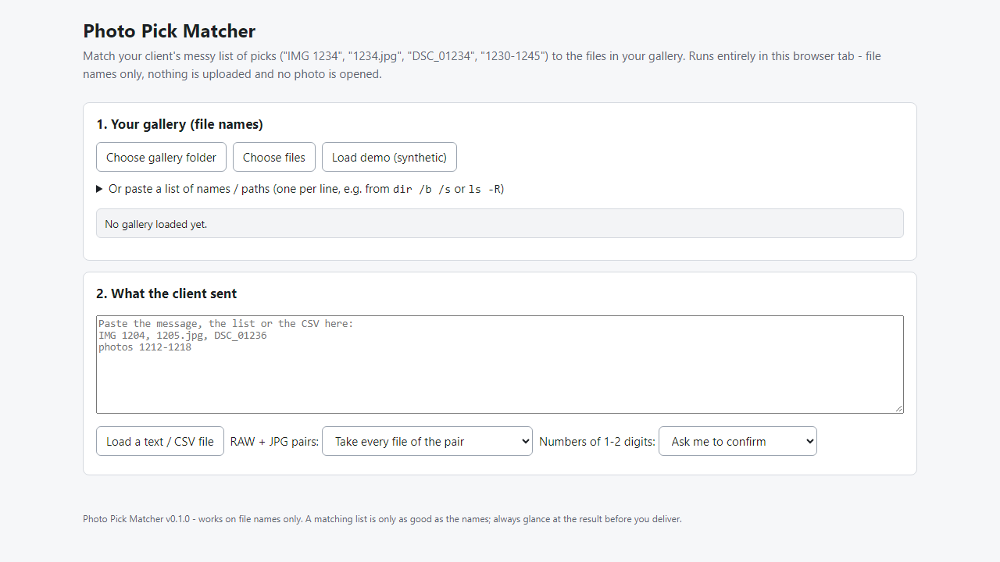
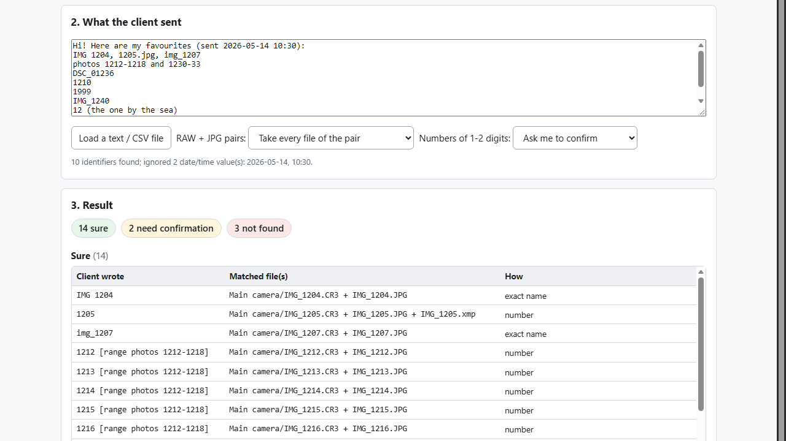

# Photo Pick Matcher

**match your client's messy picks list to your gallery files (offline)**

Offline browser tool: turn "IMG 1234", "1234.jpg", "DSC_01234", "1230-1245" into the exact files, with a confirm list, a copy script and a client report.

## What it does

**Your client sent their picks as a messy list. Find the files without hunting one by one.**

Photo Pick Matcher runs in your browser, offline. Choose your gallery folder (only file names are read), paste what the client sent - an email, a message, a CSV - and it splits the result into **Sure**, **Needs your confirmation** (several candidates - you choose) and **Not found**.

How it works
1. Open `index.html`. Choose the gallery folder (or paste a list of names).
2. Paste the client's list. Matching happens as you paste.
3. Confirm the unclear ones with a click, set aside words that were not picks.
4. Export: CSV, file list, Lightroom filter text, copy script (.bat / .sh), a report for the client of what was not found - or copy straight into a "Selection" folder in Chrome / Edge.

What it understands
- `IMG 1234`, `IMG_1234`, `1234.jpg`, `DSC_01234`, bare numbers (leading zeros and prefix ignored).
- Ranges: `1230-1245`, `IMG_1230-IMG_1245`, `1230 to 1245`, `1230-45`. Gaps in a range are listed separately.
- RAW + JPG pairs (and .xmp sidecars) as one photo: take all files, RAW only or JPG only.
- A CSV with a photo / file name column; dates and times in the message are ignored.
- It never guesses: a number shared by two cameras or folders, a prefix that does not match, or a very short number is shown with every candidate for you to confirm.

Why offline: your clients' photos and names never leave your computer. No account, subscription or server. The tool reads file names only - it never opens or modifies a photo; copying is copy-only and never overwrites.

## What it does not do

- It cannot read screenshots or images of a list (no OCR) - paste the text.
- It matches on file names only, not on picture content, and it does not read Lightroom/Capture One catalogs (it works on a folder or a pasted list of names).
- Direct copy into a folder needs Chrome or Edge; other browsers still get the CSV and the copy scripts.
- Tested in Microsoft Edge on Windows with synthetic data. Real client messages vary: formats it cannot read will show up as "Not found" - check the result before you deliver. No support or updates are promised.

## Get it

$19 one-time on Gumroad: https://asecrier.gumroad.com/l/sacgp

Product page: https://offline-tools-hub.asecrier.workers.dev/p/photo-pick-matcher
