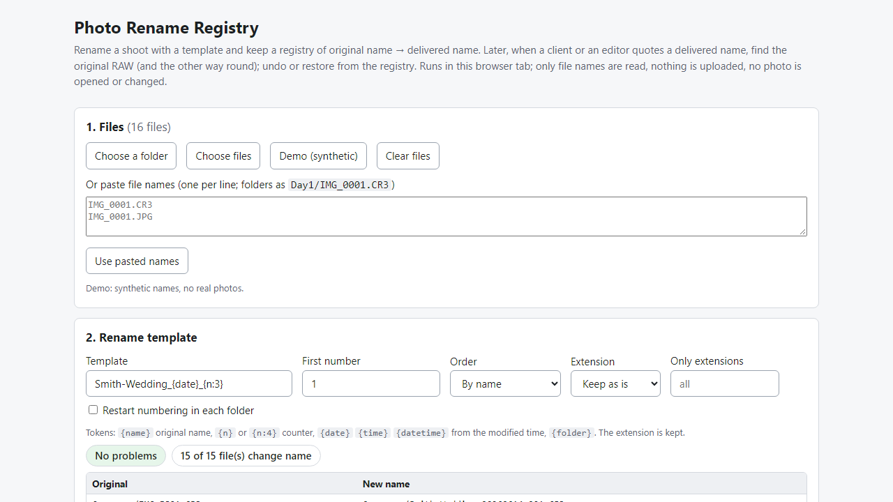
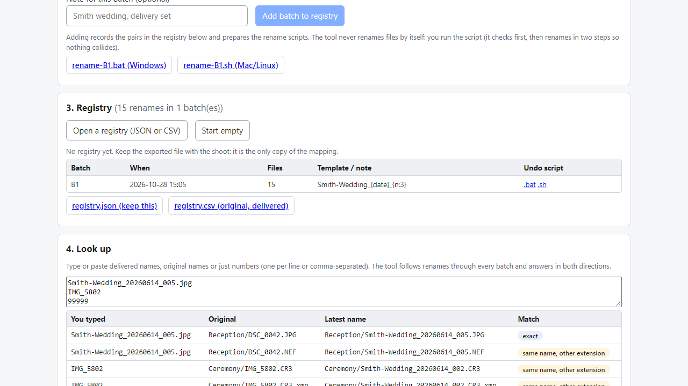

# Photo Rename Registry

**rename photos in batches and never lose the link to the original RAW (offline)**

Offline browser tool: template-rename a shoot, keep an original-to-delivered name registry, look names up both ways, undo or restore from scripts.

## What it does

**After you rename a shoot, "IMG_5802" is gone. A month later the client quotes "Smith-Wedding_002" - which RAW is that?**

Photo Rename Registry runs in your browser, offline. It reads file names only (never opens or changes a photo), renames in a batch with a template, and records every original name and delivered name in a registry file you keep with the shoot.

How it works
1. Open `index.html`. Choose the shoot folder (or paste a list of names).
2. Type a template such as `Smith-Wedding_{date}_{n:3}`. Every old -> new name is shown, with problems listed before anything is recorded.
3. Add the batch to the registry. Download the rename script (.bat for Windows, .sh for Mac/Linux) and the registry (JSON and CSV). Run the script from the shoot folder.
4. Later: open the registry, paste a delivered name, an original name, or just a number - and read the original (or the latest name). Export the answer as CSV.
5. Need to go back? Undo script per batch, or load the folder and prepare a "restore originals" script.

Details
- RAW + JPG pairs and .xmp sidecars (IMG.xmp and IMG.CR3.xmp) are renamed together under the same new name.
- Template tokens: original name, counter with padding, date/time from the file's modified time, folder name; first number, order (name / time / as listed), restart per folder, extension case, only-these-extensions filter.
- Checks first: duplicate new names (even differing by case), characters Windows forbids, reserved names, names ending in a dot/space, too-long names.
- Several batches are chained: a photo renamed twice still leads back to the camera original. Look-up tells exact, same-name-other-extension and number-only matches apart (number-only is flagged "confirm").
- Scripts verify every file first and change nothing if one is missing or a name is already taken; they then rename in two steps, so swaps cannot overwrite anything.
- Check-folder view: delivered / original / in-between / missing / not in the registry.

Why offline: client names and file lists never leave your computer. No account, subscription or server.

## What it does not do

- It does not rename files by itself - you run the generated script (you can read it first).
- It does not read EXIF, catalogs (Lightroom, Capture One) or file contents. The date token uses the file system's modified time, which may differ from the capture time.
- It cannot recover a mapping you never recorded. Start the registry before you rename, and back up the registry file with the shoot.
- If the same file name was used by different photos over time, the affected photos are marked "ambiguous" and left alone.
- Tested in Microsoft Edge on Windows with synthetic names (the real .bat and .sh scripts were run on temporary folders). Not tested with real shoots or other browsers. No support or updates are promised.

## Get it

$9 one-time on Gumroad: https://asecrier.gumroad.com/l/tbzpr

Product page: https://offline-tools-hub.asecrier.workers.dev/p/photo-rename-registry
