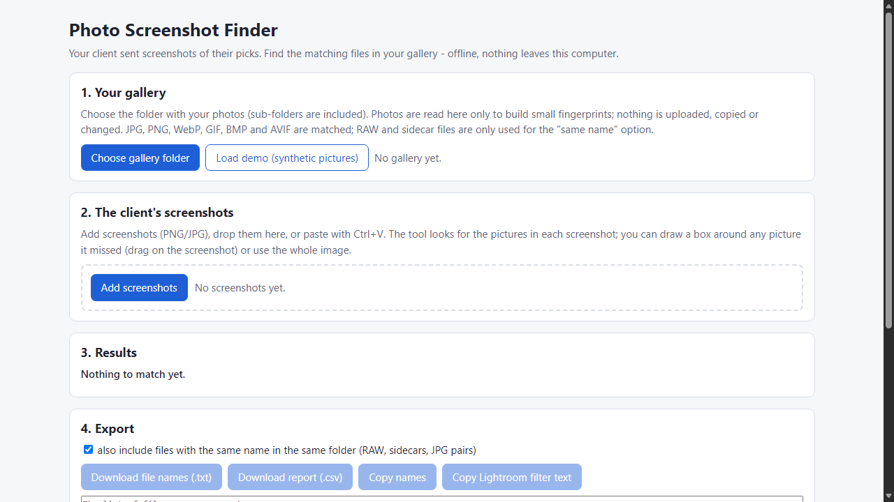
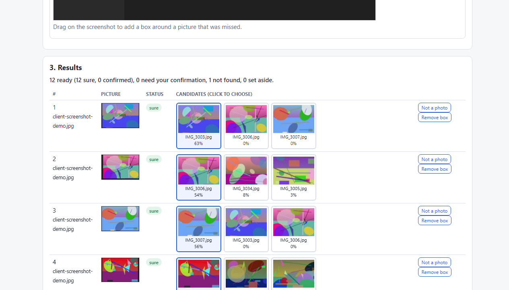

# Photo Screenshot Finder

**find the files your client picked from their screenshots (offline)**

Offline browser tool: your client sends screenshots of favourites; it finds the matching files in your gallery folder by how they look and lists the file names.

## What it does

**Your client sent screenshots of their favourites instead of file names.**

Photo Screenshot Finder runs in your browser, offline. Choose your gallery folder, add the client's screenshots (or paste them) and it finds the picture thumbnails in each screenshot, compares them with your gallery and sorts them into:
- **Sure** - clearly closest and clearly better than the runner-up,
- **Needs your confirmation** - candidates shown side by side with thumbnails, you click the right one,
- **Not found** - nothing in the gallery looks like it.

Then export the list: file names (.txt), a CSV report per screenshot picture, or text for Lightroom's filename filter. Optionally include RAW / XMP / JPG files with the same name in the same folder.

How it works
1. Open `index.html`. Choose the gallery folder (sub-folders included; photos are read here only to build small fingerprints).
2. Add screenshots (button, drag and drop, or Ctrl+V).
3. Check the boxes it found; drag a box around any picture it missed, or use the whole image for a screenshot of one picture.
4. Confirm the orange rows, export.

Why offline: your clients' photos never leave your computer. No account, subscription or server; the page cannot make network requests. The tool never changes or copies your photos.

## What it does not do

- **Tested only on synthetic pictures** (generated abstract images, simulated gallery screenshots in several styles, compression and scaling). It was NOT tested on real photographs or on real Lightroom, Explorer, Finder or phone screenshots. Real galleries may behave differently; check every result before you deliver.
- Near-identical shots (bursts) are never decided for you - they appear under "Needs your confirmation".
- Rotated or mirrored pictures, heavy filters/crops and very small thumbnails may not be found. It does not read text or file names in screenshots (no OCR).
- It does not open RAW files, does not read Lightroom / Capture One catalogs and does not copy files.
- Needs Microsoft Edge or Google Chrome (folder picker). No support or updates are promised.

## Get it

$12 one-time on Gumroad: https://asecrier.gumroad.com/l/hmkfje

Product page: https://offline-tools-hub.asecrier.workers.dev/p/photo-screenshot-finder
