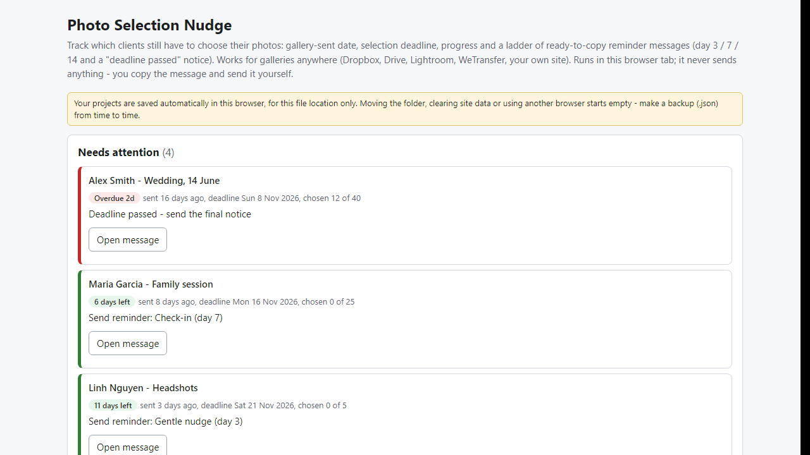
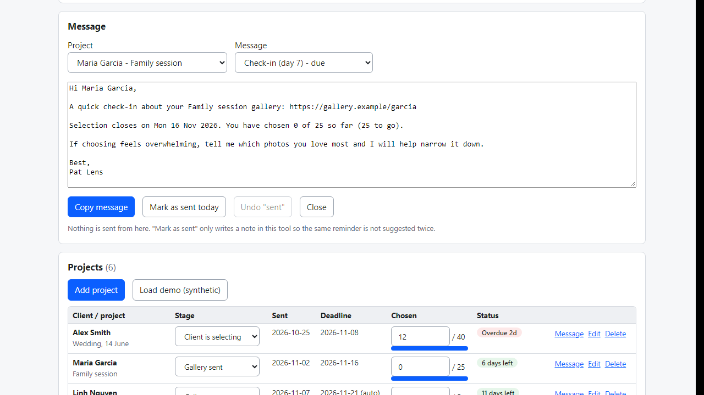

# Photo Selection Nudge

**track clients who haven't chosen their photos yet, with reminder messages ready to copy (offline)**

Offline browser tool: per-client deadline, progress and a day 3/7/14 reminder ladder with copy-ready messages, plus calendar (.ics) and CSV export.

## What it does

**The gallery went out three weeks ago and the client still hasn't picked their photos. Who needs a nudge today, and what do you write?**

Photo Selection Nudge is a small tool that runs in your browser, offline. For each project you note the date you sent the gallery, the selection deadline and how many photos the client should choose. The page then shows who needs attention today and writes the reminder for you to copy.

How it works
1. Open `index.html`. Add a project: client, shoot, gallery link (any host), sent date, deadline (or let it use sent date + your default window), target number of photos.
2. Each day check "Needs attention": overdue first, then reminders that are due, then deadlines within 2 days.
3. Click "Open message", read the text, copy it, send it yourself (email, chat, whatever you use), then "Mark as sent today".
4. Update the number of photos chosen, or set the stage to "Selection received" - reminders stop.
5. Export a calendar file (.ics) with the deadlines and upcoming reminder dates, a spreadsheet (.csv) or a backup (.json).

Details
- Reminder ladder: day 3, day 7, day 14 after sending (days editable) plus a "deadline passed" notice. Open the tool late and it suggests only the latest due message, not three at once.
- Messages are filled with client name, project, gallery link, deadline date and progress ("You have chosen 12 of 40 so far (28 to go)."). Anything missing (link, your name) stays visible as {link} / {me} and you get a warning. All texts are editable.
- Stages: preparing, gallery sent, client selecting, selection received, editing, delivered, no reply - I chose.
- Works with any gallery host - Dropbox, Google Drive, Lightroom, WeTransfer, a folder link, your own site.
- Backup file with restore (merge, keep existing or overwrite).

Why offline: client names and links never leave your computer. No account, subscription or server.

## What it does not do

- It does not send emails or messages - you copy and send them. It has no alarms of its own outside the open page; use the calendar file for alarms.
- It does not connect to Pixieset, Pic-Time or any gallery service and cannot see what a client actually chose; you type the count. If your gallery platform already sends selection reminders, you may not need this.
- The default message texts are neutral suggestions; read and adjust them to your contract (the last reminder mentions that you may continue with your own selection).
- Projects are stored in this browser for this file location only. Moving the folder or clearing site data empties it - make a backup (.json).
- Tested in Microsoft Edge on Windows with synthetic data only (26 automated checks, 28 deliberate code breakages all caught). Not tested with real clients, other browsers or by importing the calendar into every calendar app. No support or updates are promised.

## Get it

$9 one-time on Gumroad: https://asecrier.gumroad.com/l/yyypav

Product page: https://offline-tools-hub.asecrier.workers.dev/p/photo-selection-nudge
