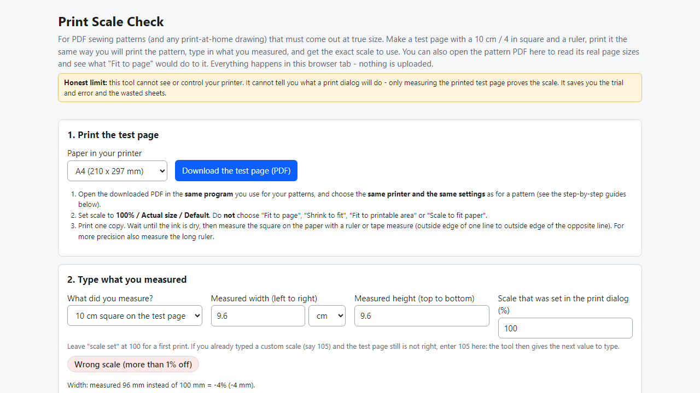
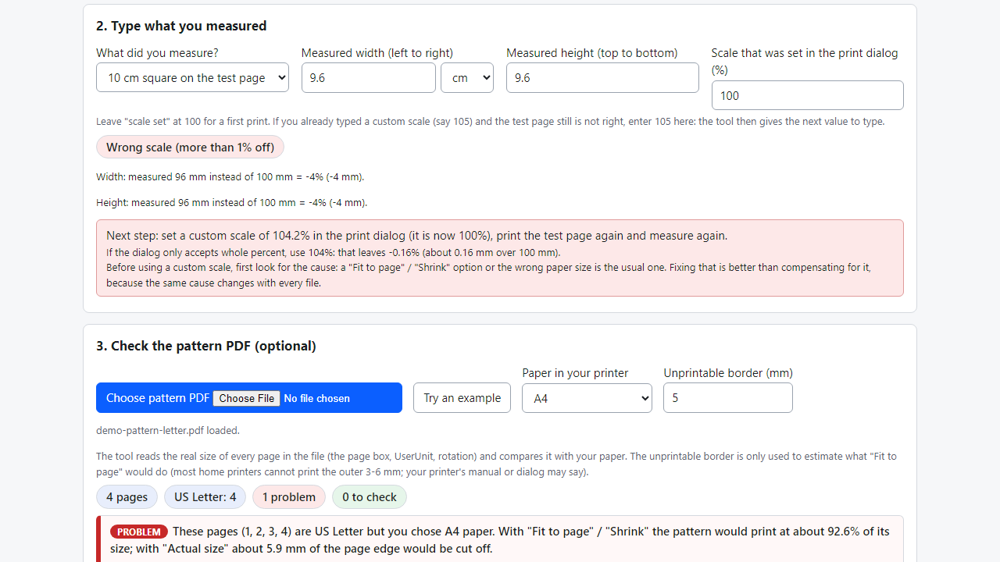
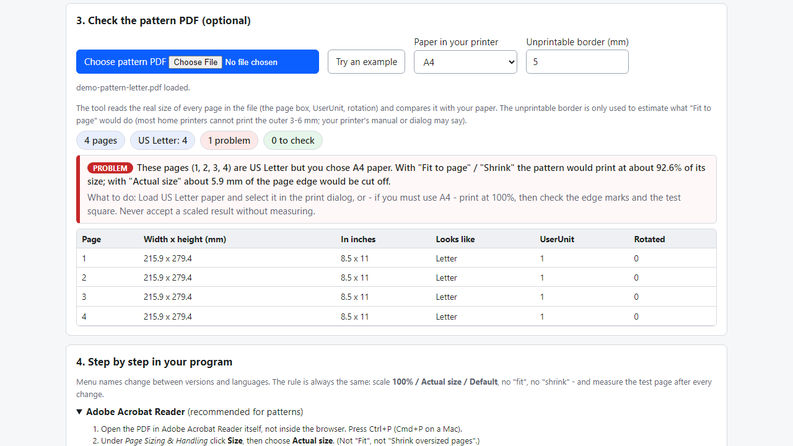

# Print Scale Check

**test page, correction percentage and paper check for PDF sewing patterns that print at the wrong size (offline)**

Offline browser tool: print a 10 cm / 4 in test page, type what you measured, get the exact print scale. Also reads your pattern PDF's real page sizes.

## What it does

**You print a 40-page PDF pattern, tape it together - and the pieces are 4% too small. The usual cause: "Fit to page" in the print dialog, or A4 paper for a Letter pattern.**

Print Scale Check runs in your browser, offline. Four steps:
- **Test page** - download a one-page PDF (A4 or US Letter) with a 10 cm square, a 4 in square, a 20 cm ruler and an 18 cm ruler, all inside the printable area. Print it with the same program and settings you use for patterns.
- **Measure** - type what you measured (cm, mm or in; width and height). The tool tells you whether the print is true to size (within 0.5%), borderline, or wrong; whether the page is stretched (width and height differ); and the custom scale to type next, e.g. 104.2% - with the whole-percent value and the error that leaves. If you already used a custom scale, it works from that. You can also enter the size of the test square that is printed on your pattern.
- **Your pattern PDF (optional)** - open the file and see the real size of every page (page box, UserUnit, rotation), whether it matches the paper in your printer, what "Fit to page" / "Shrink" would do to it on that paper (estimate), and whether it is a copy-shop size (A0/A1), has mixed page sizes or a smaller CropBox.
- **Step-by-step guides** for Adobe Acrobat Reader, Chrome, Edge and Firefox, and a list of other things that change the scale. Save or copy a text report.

Details
- Several samples included: A4 tiles, Letter tiles, A0, mixed sizes, UserUnit, CropBox, rotated, 8 x 10 in.
- No install, no account, no upload, no AI. Includes Mozilla pdf.js (Apache-2.0).

## What it does not do

- **It cannot see or control your printer or print dialog.** The only proof of scale is measuring the printed test page yourself; the tool then does the arithmetic. The "Fit to page" figure is an estimate. Menu names in the guides change between program versions and languages.
- It does not edit, rescale, tile or assemble pattern PDFs (tools such as PDFStitcher do that) and does not read your pattern's own test square.
- Hand measuring limits precision (about 0.5 mm with a good ruler). A scale typed in whole percent leaves up to 0.5%.
- Tested in Microsoft Edge on Windows with invented PDFs only (69 automated checks, the test page rendered and measured in pixels, 38 deliberate code breakages all caught). **No real printing was tested on any printer**, nor other browsers or phones. No support or updates are promised.

## Get it

$9 one-time on Gumroad: https://asecrier.gumroad.com/l/rusnim

Product page: https://offline-tools-hub.asecrier.workers.dev/p/print-scale-check
