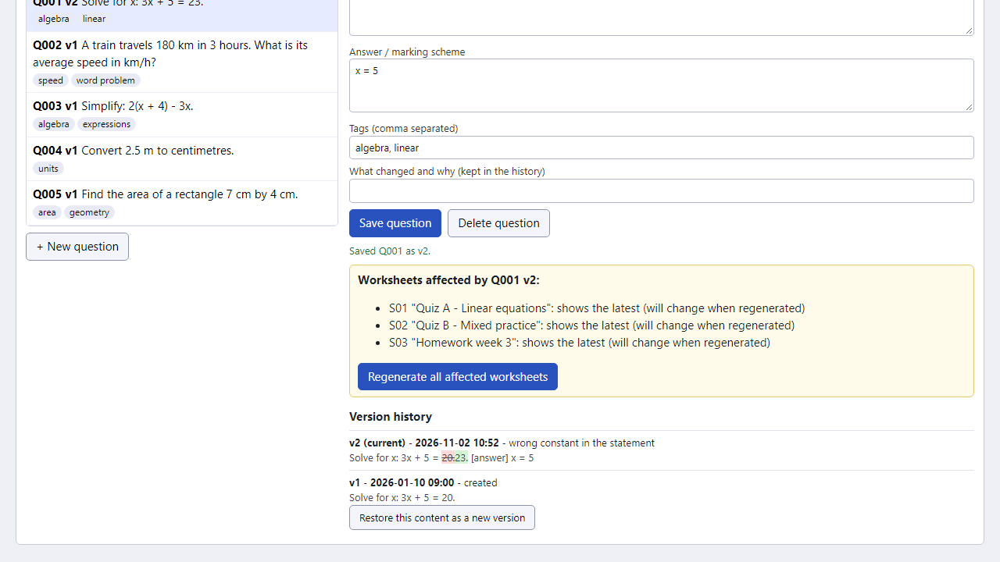
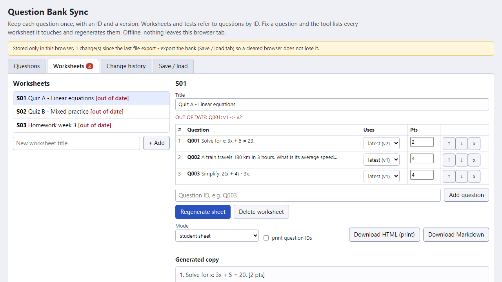
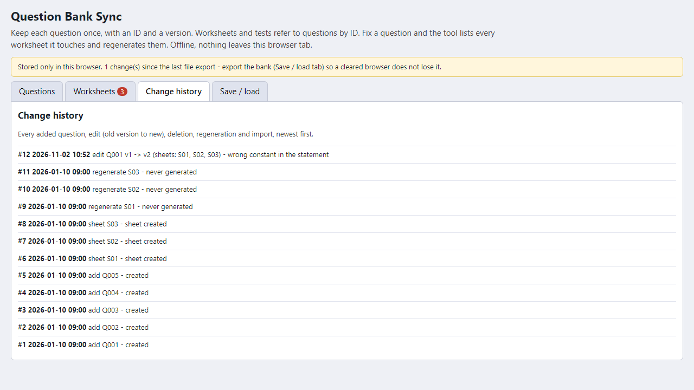

# Question Bank Sync

**fix a question once, see every worksheet it affects and regenerate them (offline)**

Offline browser tool for teachers: a bank of questions with IDs and versions, worksheets that refer to them, impact list and regeneration when you correct one.

## What it does

**You corrected the typo in one test, but the old wording is still sitting in three other worksheets.**

Question Bank Sync runs in your browser, offline. You keep each question once, with an ID. Worksheets and tests refer to questions by ID - they do not hold their own copies.

How it works
1. Open `index.html`. Add your questions: text, answer / marking scheme, tags. Each gets an ID (Q001...) and version v1.
2. Build worksheets from question IDs: order, points, and for each item either "always the latest" or "pinned to v1" (keeps the old wording on purpose).
3. Correct a question: write a short note ("wrong constant"). It becomes v2, the old version stays in the history with a word-level diff.
4. The tool lists every worksheet that uses the question - which ones will change and which are pinned - and regenerates them in one click.
5. A worksheet shows OUT OF DATE (with the reason) whenever its generated copy no longer matches the bank, and export is refused until you regenerate - so you do not print an old copy by accident.
6. Export a sheet as HTML (print from the browser; student sheet or answer key) or Markdown. A change history lists every edit and regeneration.
7. Save the whole bank as a JSON file and import it on another computer (merge never overwrites: if both copies changed the same question, the imported one is added under a new ID). The browser also keeps a copy, with a visible warning that the file is the real backup.

## What it does not do

- It does not generate test variants or random questions, and it does not render formulas or images: text is printed as typed.
- It does not connect to Word, Google Docs, Moodle or Canvas, and cannot update documents you already printed, sent or edited elsewhere - only sheets generated here are tracked. Moodle and Canvas item banks already do something similar inside their own systems; this is for people who work with printed worksheets and plain files.
- You must type or paste your questions into the bank (no import from Word/PDF).
- The browser copy is the only copy until you export the JSON file; clearing site data or using another browser loses it. No sync between several people.
- English interface only. Tested in Microsoft Edge on Windows with invented questions (automated tests, deliberate code breakages; see TEST_REPORT in the ZIP). Printing the exported HTML was not tested automatically; not tested on other browsers or phones. No support or updates are promised.

## Get it

$9 one-time on Gumroad: https://asecrier.gumroad.com/l/oteiia

Product page: https://offline-tools-hub.asecrier.workers.dev/p/question-bank-sync
