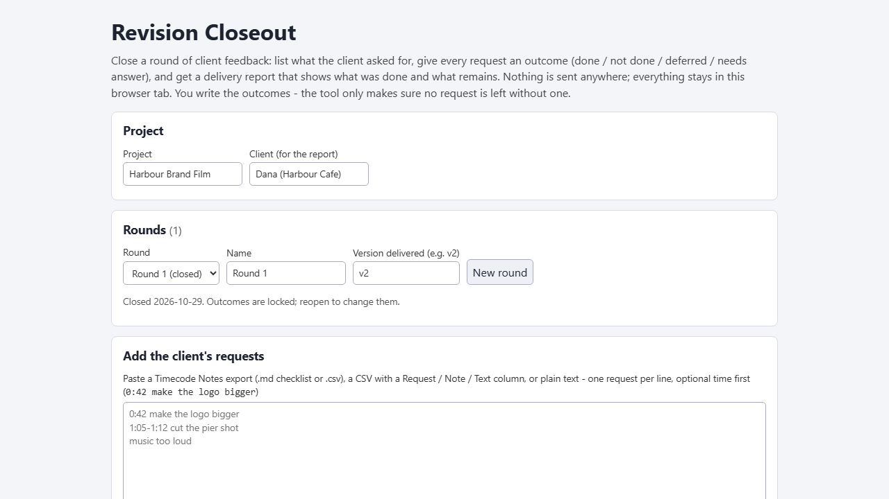
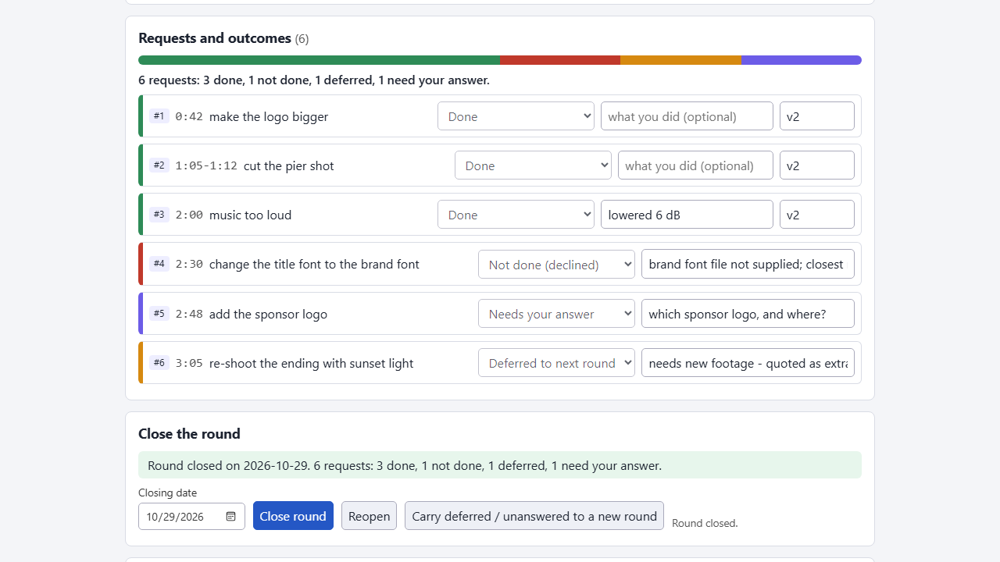
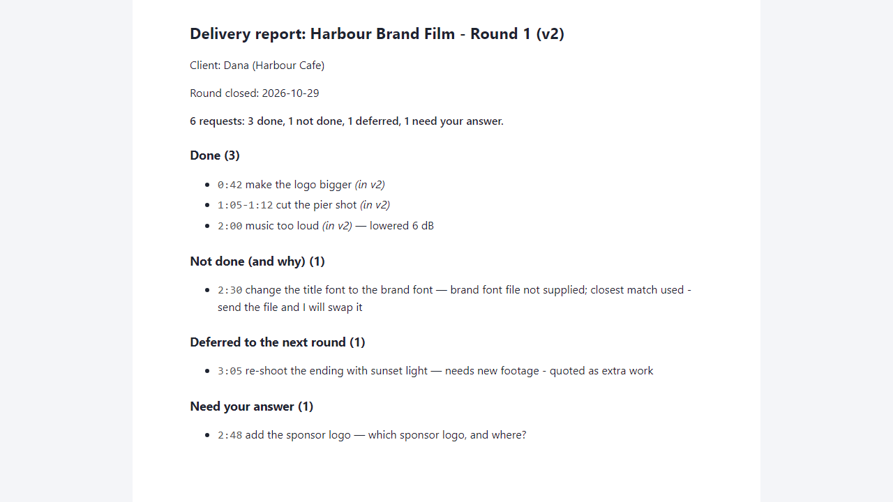

# Revision Closeout

**close a round of client video feedback with a delivery report (offline)**

Offline browser tool: give every client request an outcome, close the round, send a report of what was done and what remains. Imports Timecode Notes lists.

## What it does

**The client sent 14 changes. You did 11, one needs footage you do not have, one is unclear and one you could not do. Now they ask "did you do my notes?" - and you answer from memory.**

Revision Closeout runs in your browser, offline. Load the client's list of requests, give each one an outcome, and close the round. The tool will not close the round while any request is left without an outcome, and it asks for a reason for everything that was not done.

How it works
1. Open `index.html`. Name the project, client, round and the version you are delivering (for example v2).
2. Add the client's requests: paste or load a Timecode Notes export (.md or .csv), a CSV with a Request / Note / Text column, or plain text, one request per line (an optional time such as 0:42 or 1:05-1:12 is kept). Repeats are skipped.
3. Mark each request Done (with the version it was fixed in), Not done, Deferred to the next round, or Needs your answer. Not done / Deferred / Needs answer require a reason.
4. The close box lists what still blocks closing. Close the round: it locks and goes into the round log.
5. Export the delivery report: Markdown, a standalone HTML page for the client (no script, no network), CSV, and a cover message to copy. Count line example: "6 requests: 3 done, 1 not done, 1 deferred, 1 need your answer". Every request appears exactly once.
6. Carry deferred and unanswered requests into the next round so they cannot disappear.

Why offline and rule-based: client messages never leave your computer, and the result is the same every time. No account, subscription, server or AI service.

## What it does not do

- It does not check your video or timeline: "Done" is your own statement. The report is a record you write, not proof, not a contract, not the client's approval.
- It does not understand meaning: it does not match requests to changes, and it does not merge paraphrased requests. The imported list is the starting point; nothing checks that it is complete.
- Not a review platform: no video playback, no client login, no live sync. It does not write Premiere / Resolve / Final Cut marker files.
- English only. Data is stored in this browser for this file location - make a backup (.json).
- Tested in Microsoft Edge on Windows with invented data only (automated checks and deliberate code breakages, see TEST_REPORT in the ZIP). Not tested with real client lists, other browsers or phones. No support or updates are promised.

## Get it

$9 one-time on Gumroad: https://asecrier.gumroad.com/l/qwmlnv

Product page: https://offline-tools-hub.asecrier.workers.dev/p/revision-closeout
