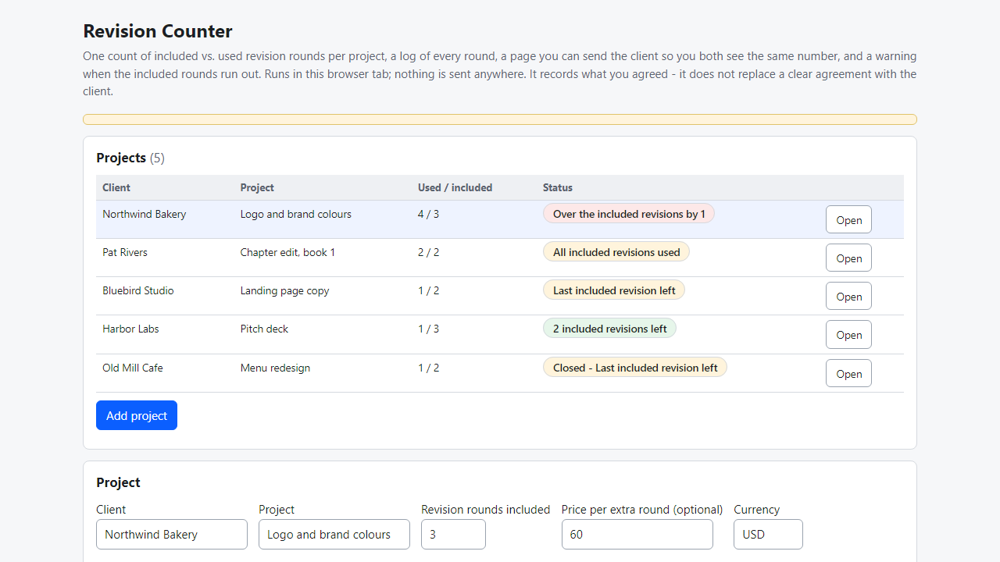
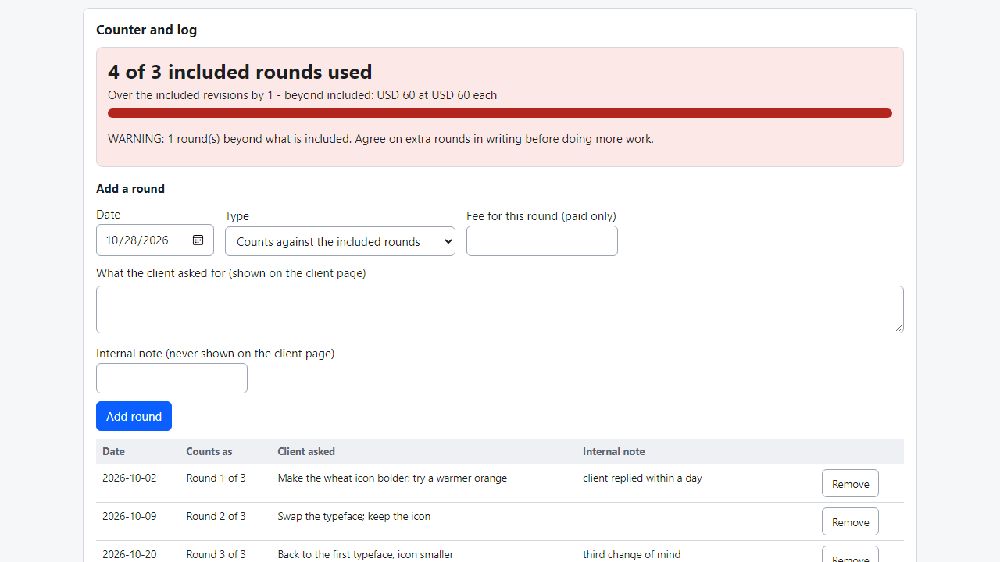
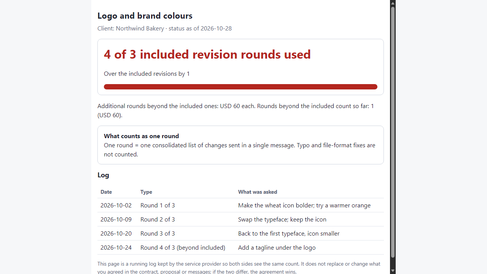

# Revision Counter

**track included vs. used revision rounds per client project (offline)**

Offline browser tool: revisions included vs. used per project, round log, warning at the limit, and a one-file page to send your client.

## What it does

**"How many revisions did I say were included?" Nobody remembers - and the client keeps sending "one more small change".**

Revision Counter is a small tool that runs in your browser, offline. For each project you note how many revision rounds are included. Each time the client asks for changes you log a round; the counter shows how many are left and warns you before and after the limit.

How it works
1. Open `index.html`. Add a project: client, project, rounds included, optional price per extra round, and a sentence on what counts as one round.
2. Log every round: date, what the client asked for, and a type - counts, small change (not counted), or paid extra round. Add an internal note if you like; it is never shown to the client.
3. Watch the counter: "2 included revisions left", then "Last included revision left", "All included revisions used", "Over by 1".
4. Click "Prepare message" for a ready text for the current state, copy it and send it yourself.
5. Download the client page: one HTML file with the count, a progress bar, your definition of a round and the log. Attach it to an email so you both see the same number.
6. Export a spreadsheet (.csv) of all projects or the log of one project, or a backup (.json).

Details
- Rounds beyond the included amount are marked "beyond included" in the log and multiplied by your extra-round price if you set one.
- The client page has no scripts and makes no network requests; internal notes are never included.
- Backup file with restore (keep existing or overwrite).

Why offline: client names and project notes never leave your computer. No account, subscription or server.

## What it does not do

- It cannot replace a clear agreement with your client. The counter helps only if the number of included rounds and the meaning of "a round" were agreed first, in your contract, proposal or messages. The client page is a log you keep, not a signed document, and says that the agreement wins.
- It does not send emails, invoice, take payment or track hours. Not legal advice.
- If a platform you use (Fiverr, Upwork, a client portal) already counts revisions per order, you may not need this.
- Projects are stored in this browser for this file location only. Moving the folder or clearing site data empties it - make a backup (.json).
- Tested in Microsoft Edge on Windows with synthetic data only (32 automated checks, 29 deliberate code breakages all caught). Not tested with real freelancers, other browsers or phones. No support or updates are promised.

## Get it

$9 one-time on Gumroad: https://asecrier.gumroad.com/l/dsqfvh

Product page: https://offline-tools-hub.asecrier.workers.dev/p/revision-counter
