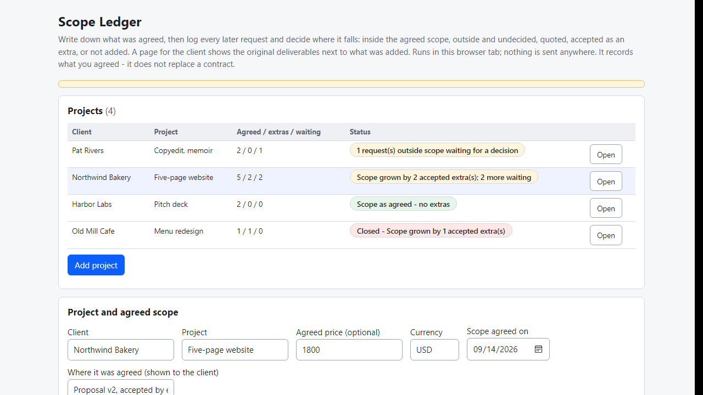
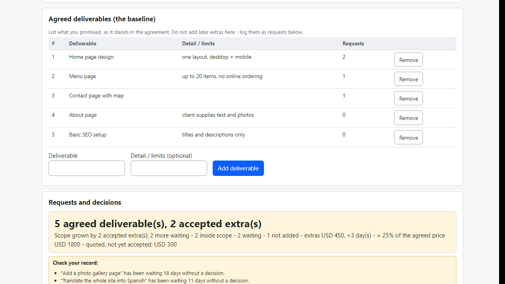
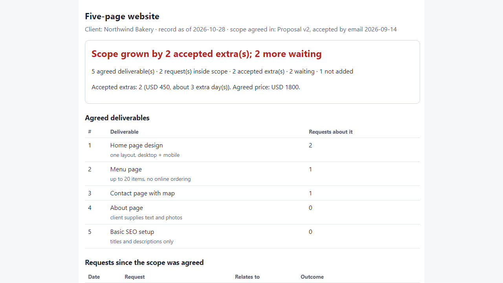

# Scope Ledger

**original deliverables vs. accepted extras per client project (offline)**

Offline browser tool: record the agreed deliverables, log each later request as in scope / extra / declined, and send the client a one-file record.

## What it does

**"It was just one small thing" - and now the project is twice the size, and nobody wrote down what the original deal was.**

Scope Ledger is a small tool that runs in your browser, offline. For each project you write down the deliverables you agreed. Every time the client asks for something more, you log the request and say where it falls. The overview shows what was agreed, what was added, what you were paid for and what is still waiting for a decision.

How it works
1. Open `index.html`. Add a project: client, project, optional agreed price, and where the scope was agreed (proposal, email).
2. List the agreed deliverables with their limits ("menu page, up to 20 items").
3. Log each request: what was asked, which deliverable it relates to, and the outcome - inside the agreed scope, outside and not decided yet, outside with a quote sent, accepted as an extra, or not added.
4. For accepted extras record the price (0 for a goodwill extra), extra days and how it was agreed ("email 5 Oct, go-ahead").
5. Read the overview ("Scope grown by 2 accepted extras; 2 more waiting") and the "Check your record" list: extras without a price or without a note on how they were agreed, in-scope requests not linked to a deliverable, requests waiting more than a week.
6. Click "Message" on a request for a ready text (confirm before starting, quote reminder, extra confirmed, not added). Copy it and send it yourself.
7. Download the client page: one HTML file with the original deliverables, every request and its outcome, and the totals. Internal notes are never included.
8. Export a spreadsheet (.csv) of all projects or the ledger of one project, or a backup (.json).

Why offline: client names and project notes never leave your computer. No account, subscription or server.

## What it does not do

- It is not a contract or a change order and cannot replace one. It only records what you tell it. The deliverables must have been agreed first, in your contract, proposal or messages, and an "accepted extra" is only as good as the agreement behind it. The client page is a log you keep, not a signed document, and says that the agreement wins.
- It does not decide what is inside or outside scope - you do. It does not read emails, count revision rounds (see the separate Revision Counter), send anything, invoice, take payment or track hours. Not legal advice.
- If you already use a hosted tool or a template that tracks change orders, you may not need this.
- Projects are stored in this browser for this file location only. Moving the folder or clearing site data empties it - make a backup (.json).
- Tested in Microsoft Edge on Windows with synthetic data only (35 automated checks, 42 deliberate code breakages all caught). Not tested with real freelancers, other browsers or phones. No support or updates are promised.

## Get it

$9 one-time on Gumroad: https://asecrier.gumroad.com/l/messcr

Product page: https://offline-tools-hub.asecrier.workers.dev/p/scope-ledger
