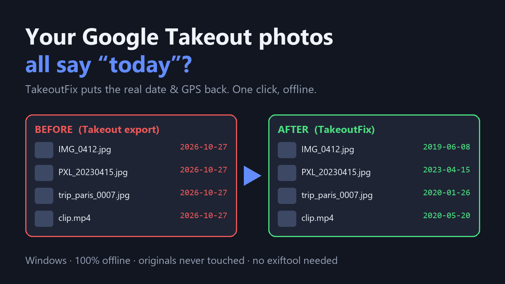

# TakeoutFix

**Restore Dates & GPS to Your Google Photos Takeout (Windows, offline)**

Google Takeout strips dates and locations from your photos. One click puts them back — offline, no installs, original files untouched.

## What it does

Downloaded your Google Photos with Takeout and every picture now says "today"? Google stores the real date and GPS in separate .json files, and since late 2024 it renames and truncates them (`.supplemental-metada.json`), which breaks the popular free scripts.

TakeoutFix reads those files and writes a corrected copy of your library:
- ✅ Real "date taken" restored (EXIF for JPEG + file created/modified dates for everything)
- ✅ GPS location restored on JPEGs
- ✅ Handles truncated sidecar names, (1) duplicates and -edited copies
- ✅ Falls back to the date in the filename (IMG_2023…, PXL_…, WhatsApp…)
- ✅ Never changes your originals; CSV report of every file
- ✅ 100% offline — your photos never leave your PC. No exiftool, no Python needed
- ✅ Dry-run mode to preview first

## What it does not do

- EXIF tags for HEIC/PNG/video are not written (file dates are fixed, though).
- The exe is unsigned, so Windows SmartScreen may ask you to confirm.
- Windows 10/11 only.

## Get it

$15 one-time on Gumroad: https://asecrier.gumroad.com/l/yylss

Product page: https://offline-tools-hub.asecrier.workers.dev/p/takeoutfix
