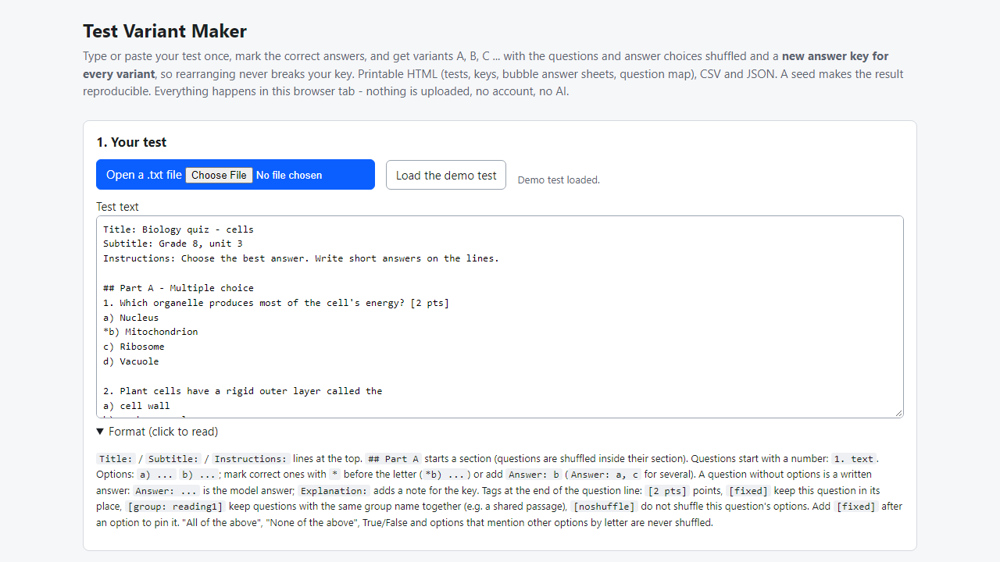
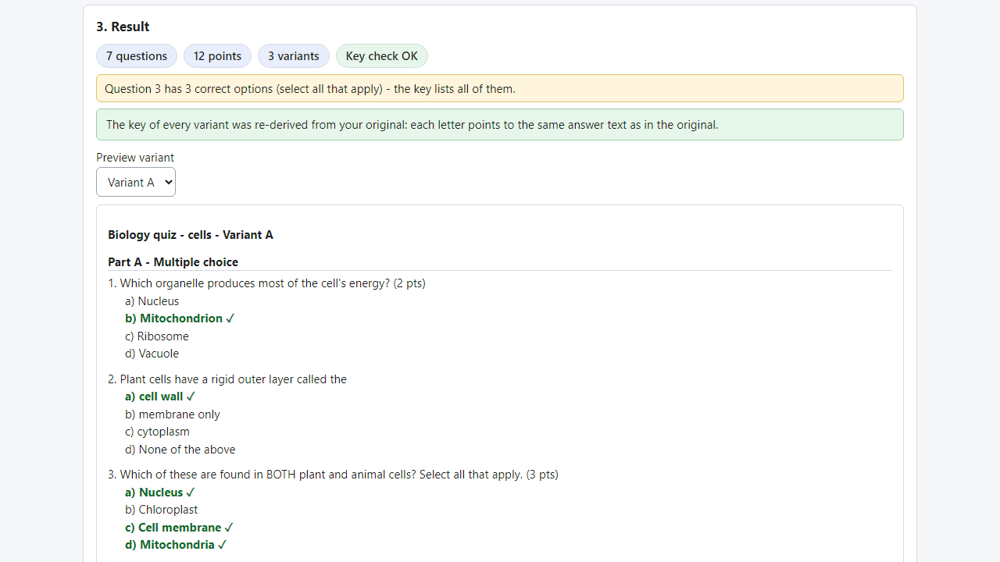
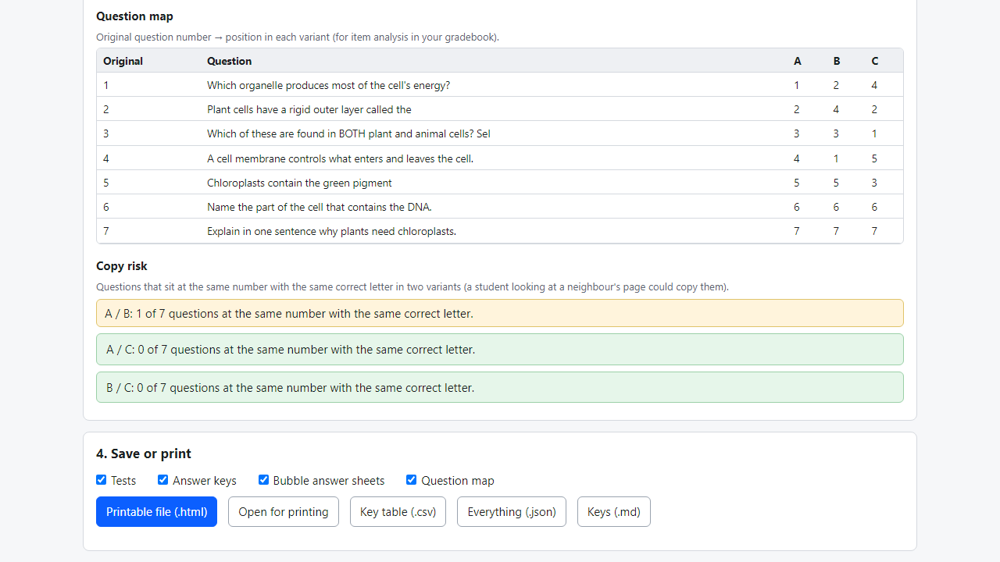

# Test Variant Maker

**test versions A, B, C with shuffled questions and a matching answer key (offline)**

Offline browser tool: write one test, get variants A-Z with shuffled questions and answers, a correct key for every variant, bubble sheets, CSV and JSON.

## What it does

**You shuffle the questions to stop copying - and now the answer key no longer matches.**

Test Variant Maker runs in your browser, offline. Type or paste your test once in plain text, mark the correct answers, choose how many variants you want, and it builds them for you:
- **Questions and answer choices shuffled** per variant (inside each section, across the whole test, or not at all). Variant A can stay exactly as you wrote it.
- **A new key for every variant**: letters, answer text, original question number, points. The tool re-derives each key from your original and checks it ("Key check OK").
- **Reproducible**: a seed - the same text and the same seed give the same variants again.
- **Things that must not move stay put**: "All of the above" / "None of the above", True/False, options such as "both a and b", questions you mark `[fixed]`; questions marked with the same `[group: name]` (a shared passage) stay together.
- **Printable file** (HTML): tests, teacher keys, answer strips, bubble answer sheets and a question map (original number -> position in each variant). Plus CSV (one row per variant question), JSON and Markdown keys.
- **Warnings**: questions that say "see question 3" or "the passage above", several correct options, missing answers, one letter correct too often, and how many questions sit at the same number with the same letter in two variants.
Supports multiple choice, select-all, True/False and written answers with a model answer. Works with English and Romanian wording (`Answer:` / `Răspuns:`).

Format example: `1. Which organelle makes energy? [2 pts]` then `a) Nucleus`, `*b) Mitochondrion`, `c) Ribosome`.

## What it does not do

- Plain text only: no formulas, pictures, tables or matching questions (put them in as text or mark `[fixed]`).
- It cannot understand your wording; a question that depends on another question, or on option letters, can still break - the warnings are rules, not understanding. Read the printed variants and keys once before the exam.
- It does not grade students, scan answer sheets, run online tests or connect to Moodle / Google Forms / Quizlet.
- Real printing was not tested automatically. Tested in Microsoft Edge on Windows with invented tests only (46 automated checks, 80 random tests verified by independent code, 33 deliberate code breakages all caught). Not tested on real teacher files, other browsers or phones. No support or updates are promised.

## Get it

$9 one-time on Gumroad: https://asecrier.gumroad.com/l/uvrpn

Product page: https://offline-tools-hub.asecrier.workers.dev/p/test-variant-maker
