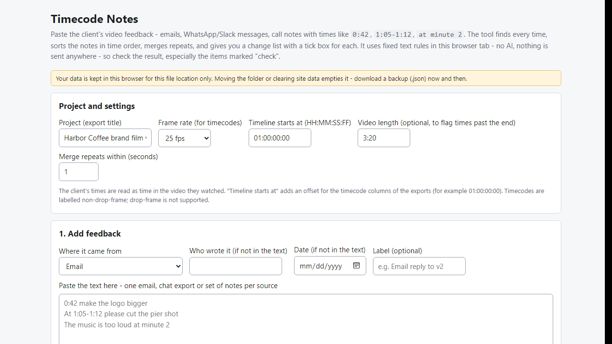
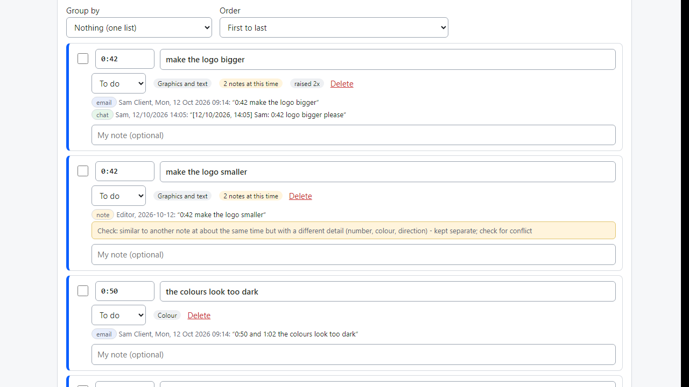
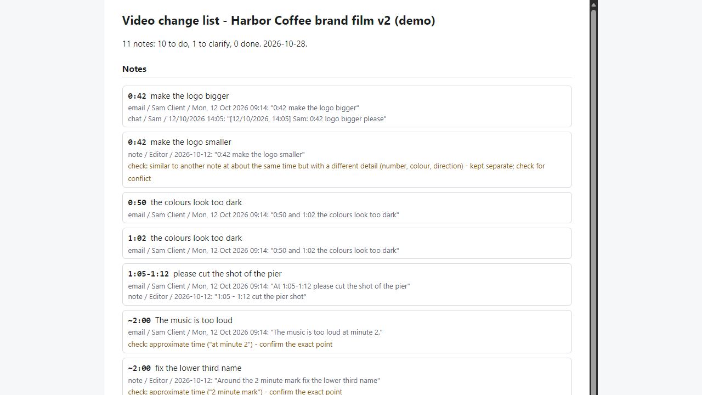

# Timecode Notes

**turn client video feedback with minute:second times into a sorted change list (offline)**

Offline browser tool: paste client emails, chats and notes with times like 0:42 or 1:05-1:12; get one time-sorted change list with checkboxes and exports.

## What it does

**The client's feedback says "0:42 make the logo bigger", "at 1:05-1:12 cut the pier shot" and "music too loud at minute 2" - spread over an email, WhatsApp and your call notes - and you still have to turn it into one list in time order.**

Timecode Notes runs in your browser, offline. Paste or load the pieces; it finds every time, sorts the notes chronologically, merges repeats (and remembers where each came from: email, chat or note, who, when), and gives you a change list with a tick box for each note.

How it works
1. Open `index.html`. Set the frame rate, and optionally where your timeline starts (for example 01:00:00:00) and the video length.
2. Choose Email, Chat or My own notes, paste the text (or load a .txt / .eml file), press Add. Repeat for each source.
3. Times understood: m:ss, h:mm:ss, decimals, frames (00:01:02:12), ranges (1:05-1:12, "from 1:05 to 1:12", "between 1:05 and 1:12"), lists ("0:50, 1:02 and 1:10 too dark"), several notes in one line, and wording such as "at minute 2", "the 2 minute mark" or "at 1m30s" (minutes-only wording is marked approximate, ~2:00).
4. WhatsApp-style prefixes ([12/10/2026, 14:05] Sam:) are removed first, so a message time is not mistaken for a video time. Email headers, quoted replies and "On ... wrote:" chains are skipped. 16:9 and 10:30 AM are not treated as video times.
5. Notes that need a human look are marked "Check": approximate times, times past the end of the video, reversed ranges, text split between several times, and notes that look alike but differ in a number, colour or opposite word (bigger/smaller) - those are never merged.
6. Group by minute, by type (audio, colour, graphics, cuts) or by who asked; list first-to-last or last-to-first (so you can cut from the end of the video and keep the earlier times valid).
7. Export a Markdown checklist, a CSV spreadsheet (with start/end timecodes using your frame rate and timeline start), a plain timecode list (01:00:42:00  make the logo bigger), or a standalone HTML page; back up and restore as JSON.

Why offline and rule-based: client messages never leave your computer, and the result is the same every time. No account, subscription, server or AI service.

## What it does not do

- It does not understand meaning. It uses fixed rules. A time written in an unusual way can be missed; a clock time such as "at 14:05" can be mistaken for a video time; a sentence with several times and several remarks can be split wrongly (those are marked Check). "The logo is too small" and "make the logo bigger" are NOT recognised as the same note. Always glance over the list.
- It does NOT write Premiere Pro, DaVinci Resolve or Final Cut Pro marker files. The CSV and the timecode list are meant to be read or pasted into the tool you use.
- English only. It does not read screenshots, PDFs, voice notes or comments exported from review sites. The client's times refer to the version they watched; after you edit, later times shift and the tool does not move them. Timecodes are non-drop-frame labels.
- Data is stored in this browser for this file location. Moving the folder or clearing site data empties it - make a backup (.json). It does not send anything and does not replace the client's approval.
- Tested in Microsoft Edge on Windows with invented data only (44 automated checks, 40 deliberate code breakages all caught). Accuracy on real client messages is unknown. Not tested with other browsers or phones. No support or updates are promised.

## Get it

$9 one-time on Gumroad: https://asecrier.gumroad.com/l/oxqdf

Product page: https://offline-tools-hub.asecrier.workers.dev/p/timecode-notes
