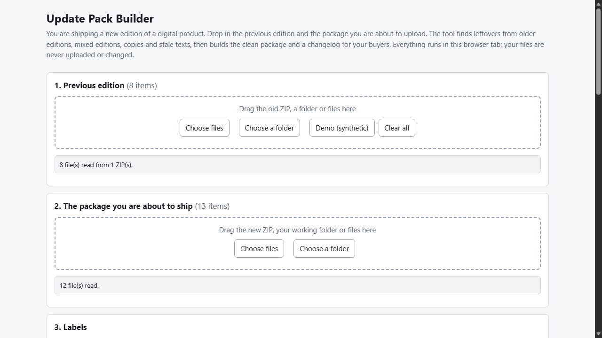
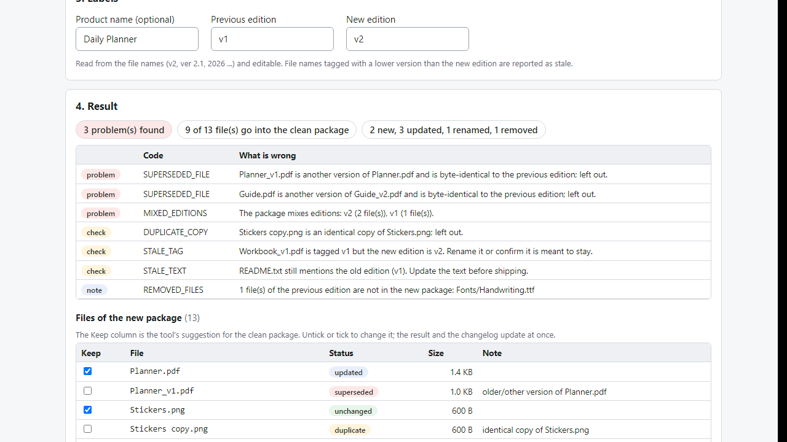

# Update Pack Builder

**ship a new edition without old files in the ZIP (offline)**

Offline browser tool: compare your old and new product package, find leftover old-edition files, build the clean ZIP and a buyer changelog.

## What it does

**You updated your product to v2. Is there still a v1 file in the ZIP?**

Drop in the previous edition and the package you are about to upload. The tool compares them (file names, sizes, checksums) and tells you, before a buyer finds out:

- **Leftovers from older editions**: Guide.pdf next to Guide_v2.pdf, Planner_v1.pdf beside the new Planner.pdf, including files byte-identical to the previous edition.
- **Mixed editions**: files tagged v1 and v2 in one package; tags lower or higher than the edition you are shipping.
- **Housekeeping**: "copy" / "(1)" suffixes, identical copies, files named old / backup, empty files, .DS_Store and __MACOSX junk.
- **Stale texts**: README.txt / .md / .html that still say "v1" or the old year.
- **What changed**: new, updated, renamed (same content) and removed files against the previous edition.

Then it builds:
- the **clean package ZIP** (kept files only, optional product-edition folder, optional CHANGELOG.md, re-read and CRC-checked),
- a **changelog** (Markdown) you can paste into your product page or e-mail to existing buyers,
- a report (.txt, .csv).

You stay in control: every file has a Keep checkbox; the result and the changelog update at once. Works for templates, printables, fonts, asset packs, ebooks, courses - any digital product on Gumroad, Etsy, Payhip, Shopify or your own store. Your files never leave your computer: no account, no upload, no server. Double-click index.html in Edge/Chrome.

## What it does not do

- It does not open PDFs, images or spreadsheets to compare their content: a changed file with the same name is simply "updated".
- It cannot know which of two differently named files you meant to keep; it follows version tags, copy/old markers and the previous edition, and you decide with the Keep boxes.
- Stale text is searched in plain-text files only (txt, md, html, csv ...), not inside PDFs or Word files.
- ZIPs inside the package are treated as single files; no encrypted ZIP, ZIP64, RAR or 7z. It does not connect to any store and does not check marketplace limits.
- Free alternatives exist (folder diff tools, checking by eye); this one reads version tags and builds the clean package and the changelog.
- Tested with Microsoft Edge on Windows with synthetic files plus an independent Python re-check. Not tested in other browsers or with real shop files. No support or updates promised.

## Get it

$9 one-time on Gumroad: https://asecrier.gumroad.com/l/yzgla

Product page: https://offline-tools-hub.asecrier.workers.dev/p/update-pack-builder
