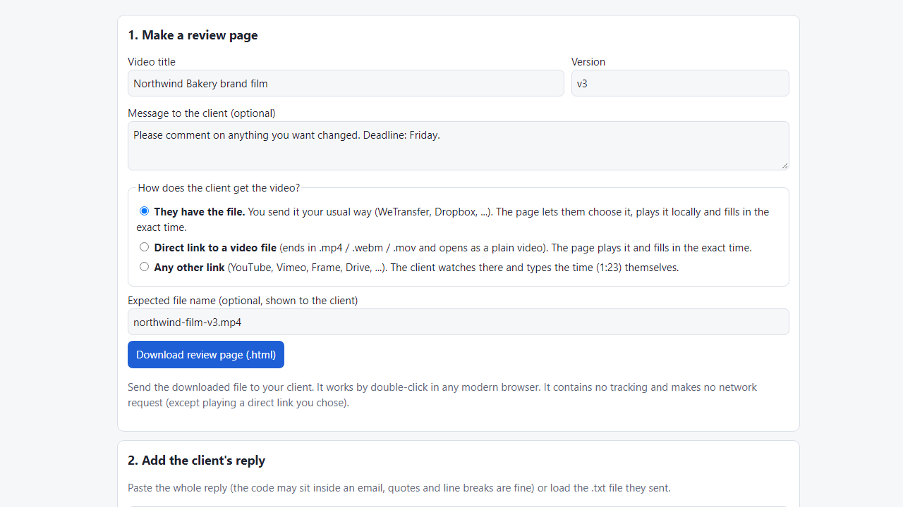
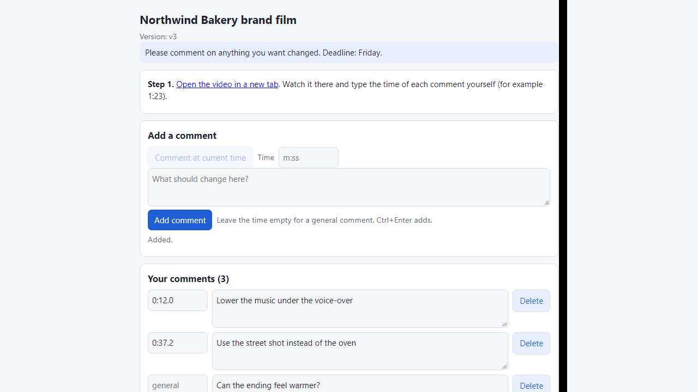
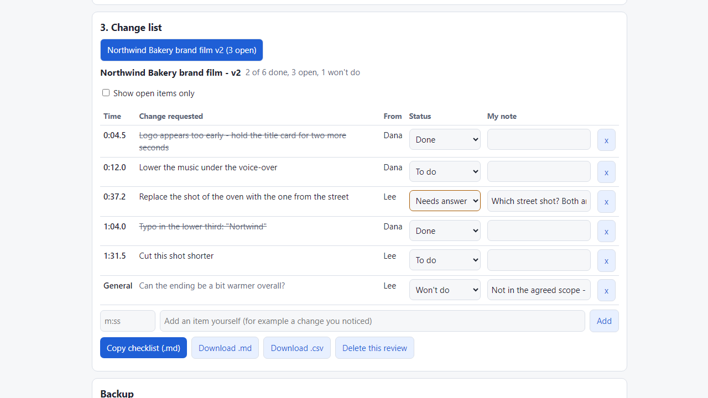

# Video Feedback Link

**one-file review page for clients, timecoded comments back (offline)**

Offline tool: make a one-file video review page for your client, get timecoded comments back as copy-paste text, and import them into a change list.

## What it does

**The client won't make an account on a review platform. They reply "around the middle the music is too loud".**

Video Feedback Link makes a single HTML file you email to the client. They open it, watch the video, press "Comment at current time" and type what should change. When they are done they copy the result (or download a .txt) and send it back in their normal reply. You paste it into the tool and get a change list with exact times. No server, no account, no subscription.

How it works
1. Open `index.html`. Give the video a title and version, and choose how the client gets the video:
   - they have the file you sent (the page lets them choose it and plays it locally, nothing is uploaded),
   - a direct link to a video file (.mp4/.webm), or
   - any other link (YouTube, Vimeo, Drive...): they watch there and type the time themselves.
2. Download the review page and send it.
3. The client adds comments (time filled in from the player, or typed), edits them, and copies the feedback text.
4. Paste the reply into the tool (email quoting and line breaks are fine) or load the .txt. Comments appear with times, author and a status.
5. Mark items To do / Done / Needs answer / Won't do, add notes and your own items, copy a checklist (.md) or download .md / .csv. Backup and restore (.json).

Details
- The pasted code has a checksum: a reply that was cut or changed in transit is refused with a clear message; the readable lines are still in the message.
- Importing the same reply twice does not duplicate items. The same note from two different people is kept.
- The client page has no network access of its own (strict page policy, tested) and keeps the client's draft in their browser if they close it.
- Works offline; your project names and client comments stay on your computer.

## What it does not do

- It is not a proofing platform: no drawing on frames, no live sync, no approvals, no notifications. The return trip is text the client copies and sends back - there is no server.
- With non-direct links (YouTube, Vimeo, Frame, Drive...) the page cannot read the player, so the client types the times.
- Times are as accurate as the client's player, to 0.1 s. No frame-accurate or drop-frame timecode.
- Playback depends on the client's browser; common H.264 .mp4 usually plays, some .mov/.mkv files do not.
- Your lists are stored in your browser for this file location only; moving the folder or clearing site data empties them - make a backup (.json).
- It does not replace a clear agreement with your client about rounds of changes.
- Tested in Microsoft Edge (headless) with synthetic data (47 automated checks, 40 deliberate code breakages all caught), including a real generated video played through the page. Not tested with real clients, other browsers, phones, or real mail clients. No support or updates are promised.

## Get it

$9 one-time on Gumroad: https://asecrier.gumroad.com/l/iedngy

Product page: https://offline-tools-hub.asecrier.workers.dev/p/video-feedback-link
