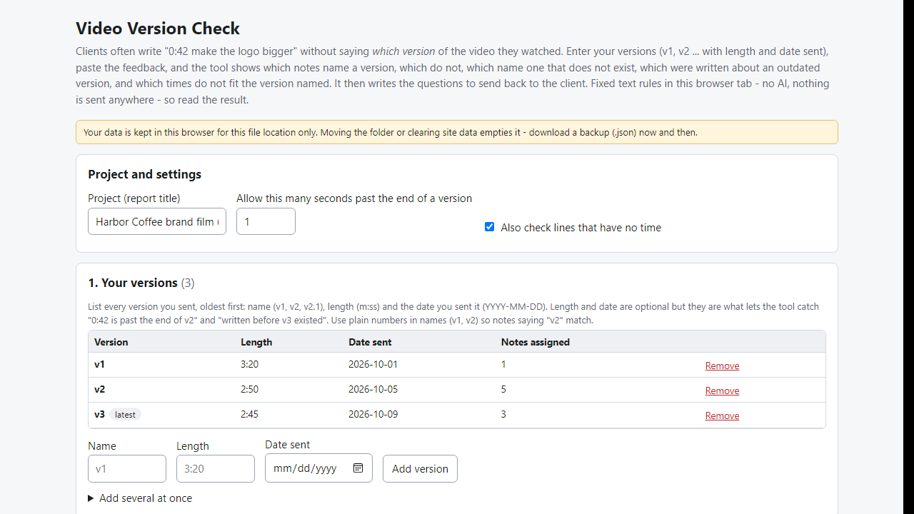
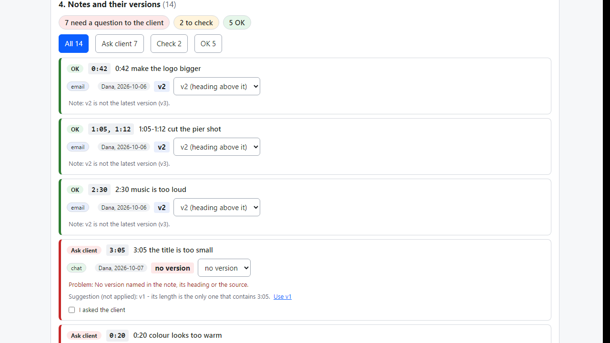
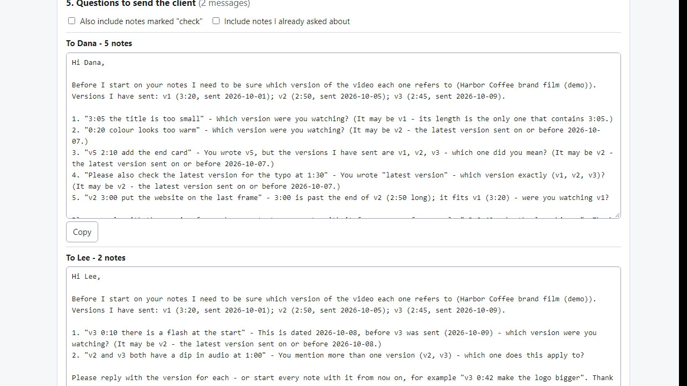

# Video Version Check

**find client notes that don't say which video version (offline)**

Offline browser tool: list your versions (v1, v2 ...), paste client notes; see which notes name no version or a wrong one, and copy the questions to send.

## What it does

**The client writes "3:05 the title is too small" - but which version were they watching? v2 is only 2:50 long.**

Video Version Check runs in your browser, offline. You list the versions you sent (v1, v2, v3 with length and date sent). You paste the client's emails, chat messages and your call notes. For every note the tool shows which version it refers to - or why it cannot tell - and writes the questions to send back.

How it works
1. Open `index.html`. Enter your versions: name, length (m:ss), date sent.
2. Choose Email, Chat or My own notes, paste the text (or load a .txt / .eml file), optionally say "every note here is about v2", press Add. Repeat per source.
3. A version is read from v2, V2.1, version 2, rev 4, cut 3, draft 2 or a file name such as Harbor_v2.mp4; "Notes on v2:" lines set the version for the lines below. "The second cut" is read but marked "confirm"; "the latest version" is flagged, not guessed.
4. Each note is marked OK, Check or Ask client. The tool flags: no version named; two versions in one note; a version you never sent; a note dated before that version was sent; a time past the end of that version ("3:00 is past the end of v2 (2:50 long); it fits v1 (3:20)"); a version already replaced by a newer one when the note was written; a note that disagrees with its heading.
5. Suggestions ("3:05 only fits v1") are shown with the reason and never applied unless you press the button. You can also pick the version yourself.
6. Section 5 writes one message per person: numbered questions with each quoted note, the list of versions you sent, and a request to start every note with its version. Tick "I asked the client" so you don't ask twice.
7. Export a Markdown report, a CSV spreadsheet, a standalone HTML page, the questions as text, or a JSON backup.

Why offline and rule-based: client messages never leave your computer, and the result is the same every time. No account, subscription, server or AI service.

## What it does not do

- It does not understand meaning. It uses fixed rules. A version written in an unusual way can be missed, and a number after "cut" or "draft" that is not a version can be read as one. Always glance over the list.
- It cannot know which version the client really watched - it finds notes that don't say, or contradict your version list. The answer has to come from the client.
- Length and date checks only work if you enter lengths and dates. Version names should contain a plain number (v1, v2).
- It does not build a change list and does not write Premiere, Resolve or Final Cut marker files. Times are read as m:ss / h:mm:ss only (not frames). English only. It does not read screenshots, PDFs, voice notes or review-site exports.
- It is not a record of what the client approved and has no legal value.
- Data is stored in this browser for this file location. Moving the folder or clearing site data empties it - make a backup (.json). It does not send anything.
- Tested in Microsoft Edge on Windows with invented data only (44 automated checks, 43 deliberate code breakages all caught). Accuracy on real client messages is unknown. Not tested with other browsers or phones. No support or updates are promised.

## Get it

$9 one-time on Gumroad: https://asecrier.gumroad.com/l/uohuuh

Product page: https://offline-tools-hub.asecrier.workers.dev/p/video-version-check
