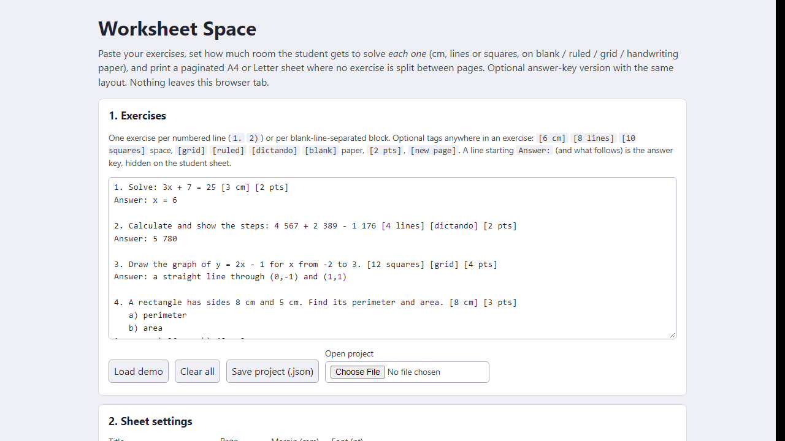
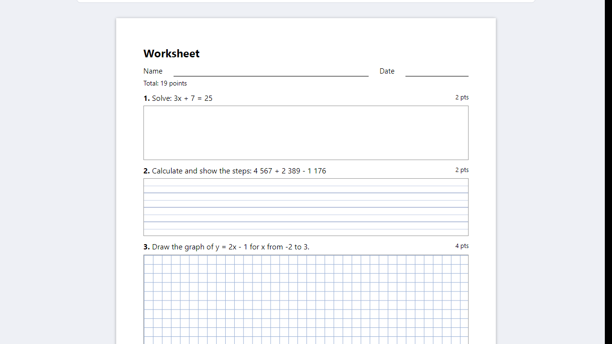
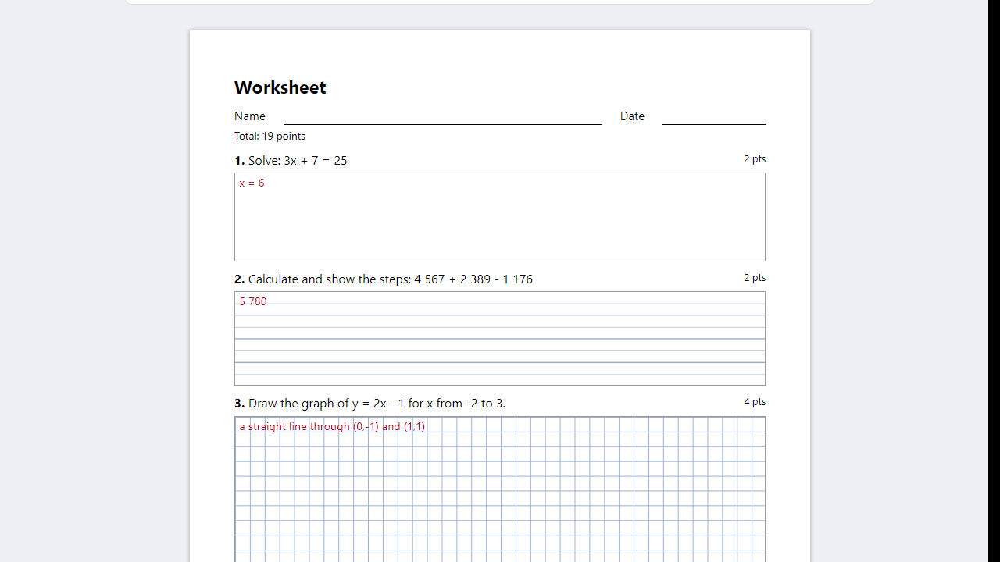

# Worksheet Space

**set the solving space for each exercise, print worksheets that never split an exercise (offline)**

Offline browser tool for teachers: your exercises, your own solving space per exercise (cm, lines, squares), A4/Letter pages that never split one. Print or PDF.

## What it does

**Your students keep writing in the margins because the worksheet left two lines for a problem that needs ten.**

Worksheet Space runs in your browser, offline. Paste your exercises, decide how much room each one gets, and print a paginated sheet.

How it works
1. Open `index.html`. Paste your exercises (numbered lines or blank-line-separated blocks).
2. Give each exercise its own space: 3 cm, 8 lines, 12 squares - in a table or with a tag like `[8 cm]` in the text. Choose blank, ruled, grid or handwriting (dictando-style) paper per exercise, or use a default for all.
3. One setting scales every space at once (x1.5 = 50 % more room).
4. The tool paginates A4 or Letter without splitting an exercise, shows how full each page is, and warns when an exercise cannot fit a page.
5. Print or Save as PDF from the browser. Student sheet and answer key use the identical layout; the key shows your answers in red inside the space.
6. Save the project as a file and reopen it later.

Also: optional points per exercise with a total, forced page breaks, name/date line, margins and font size.

## What it does not do

- It is not an equation editor: text is printed as typed (use Unicode symbols). It does not generate or randomise exercises, and it is not a question bank.
- It keeps your order and never reorders to fill gaps, so a page can end with white space.
- Exact space on paper needs printing at 100 % (no "fit to page").
- English interface only. Data is stored in this browser - save the project (.json) as backup.
- Tested in Microsoft Edge on Windows with invented exercises (automated layout checks, real print-to-PDF page counts, deliberate code breakages; see TEST_REPORT in the ZIP). Not tested on real printers, other browsers or phones. No support or updates are promised.

## Get it

$9 one-time on Gumroad: https://asecrier.gumroad.com/l/nkhlxr

Product page: https://offline-tools-hub.asecrier.workers.dev/p/worksheet-space
